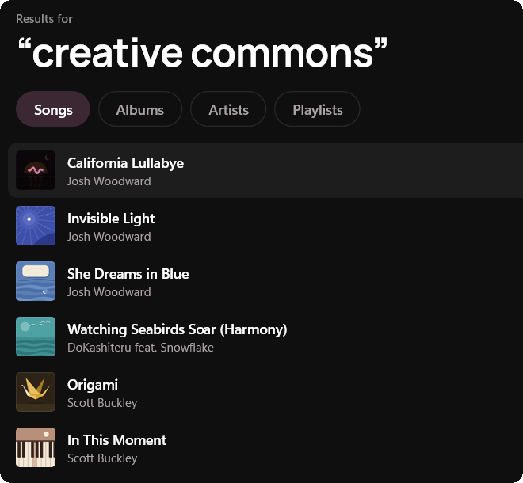
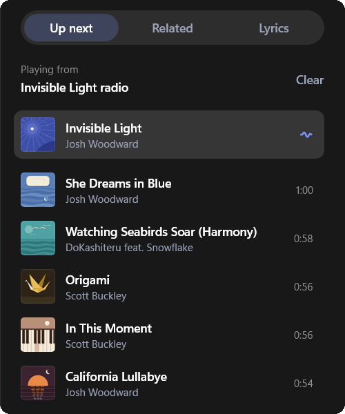
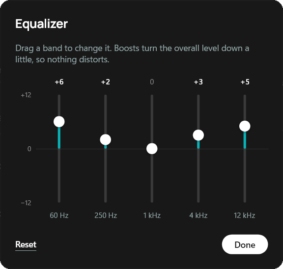
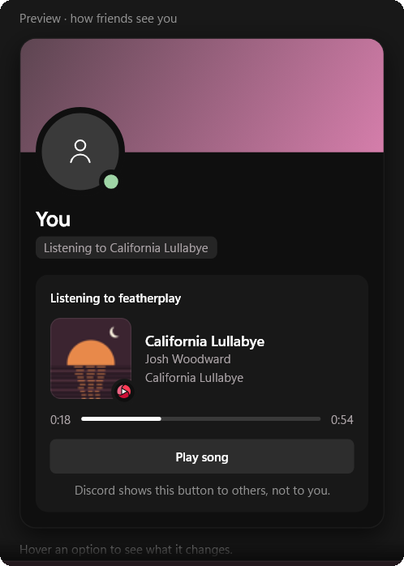
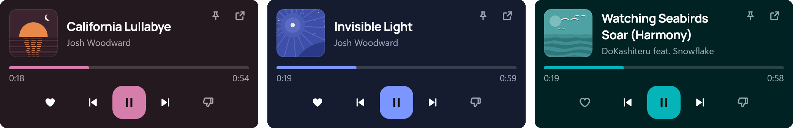
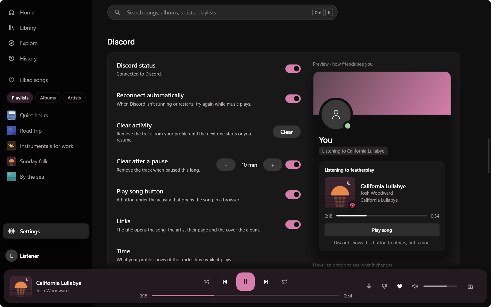
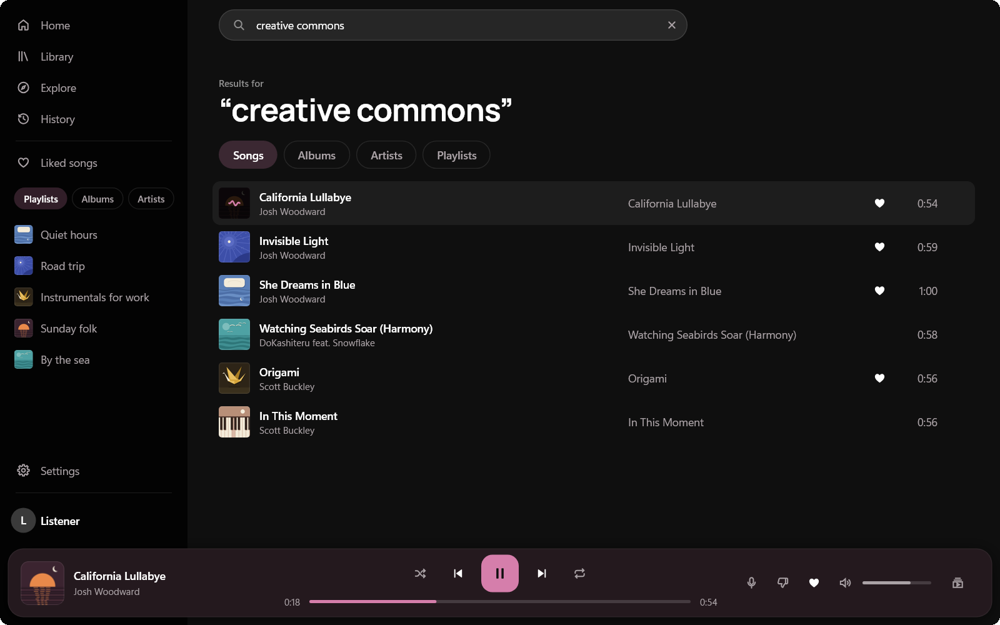

<!--
  Images in .github/readme/: rendered offscreen by featherplay's own `--snapshot` mode with the
  demo fixtures (FEATHERPLAY_FIXTURES=demo: six free-licence songs, our own cover art, a plain
  "Listener" account), not screen captures (except tray.png, below). The window is at its
  default size, 1280 x 800, at 125 %. The script that renders them, cuts the details and
  composes the header is kept outside the repo.

  header-dark.png, header-light.png  The header: icon, wordmark, line, measured figures, and a laptop
                                     showing Now playing with lyrics over the cover's glow (1600 x 900).
  hero-dark.png, hero-light.png      Home with a song playing, the bar visible.
  now-playing-lyrics.png             Now playing with the full lyrics view, the current line lit.
  theme-dark.png, theme-light.png    The same playlist, same song, in each theme.
  settings-discord.png               Settings at the Discord group (`--snapshot settings-discord`):
                                     the profile card beside its options.
  search.png                         Search results.
  mini-player.png                    The tray's mini player (200 %).
  feature-*.png                      The pictures beside Features, cut from the same renders: search,
                                     Up next, the Equalizer, the Discord card, and the mini player
                                     with three covers, each giving its accent.
  tray.png                           The one real capture: the tray's tooltip and menu are Windows'
                                     own, so the snapshot mode can't draw them. A free-licence song
                                     playing (muted), the window on Settings behind; other apps'
                                     tray icons blurred (4K at 150 %).
  MadeWithSlint-logo-*.svg           Slint's attribution badge, which its Royalty-free License
                                     asks for: unmodified copies of slint-ui/slint logo/
                                     (CC BY-ND 4.0, SixtyFPS GmbH).
-->

<p align="center">
  <picture>
    <source media="(prefers-color-scheme: light)" srcset=".github/readme/header-light.png">
    
  </picture>
</p>

<p align="center">
  <a href="https://github.com/candygoogy/featherplay/releases/latest"><b>Download for Windows</b></a>
  &nbsp;·&nbsp; Windows 10 and 11, x64 and ARM64 &nbsp;·&nbsp; free and open source
</p>

featherplay plays your YouTube Music library, playlists, search results and radio from one
native Windows program. It's written in Rust and drawn with Slint, so no web browser runs
behind the window and nothing plays but the audio. It keeps what people use most in Pear
Desktop (scrobbling, media keys and taskbar buttons, SponsorBlock, Discord status) and uses
about a twentieth of its memory ([How light?](#how-light)).

> [!NOTE]
> **Unofficial.** featherplay is an independent project. It isn't made, endorsed or supported
> by Google or YouTube, and it uses YouTube Music's private web interface, which can change
> without notice. **If playback breaks, update; YouTube changes things.**

**Start:** [Install](#install) · [Windows protected your PC](#windows-protected-your-pc) ·
[The first run](#the-first-run) · [Signing in](#signing-in)<br>
**What it is:** [Why](#why) · [What it leaves out](#what-it-leaves-out) ·
[Features](#features) · [Screenshots](#screenshots) · [How light?](#how-light)<br>
**Reference:** [Coming from Pear?](#coming-from-pear) · [Questions](#questions) ·
[Privacy](#privacy) · [Local API](#local-api) · [Build from source](#build-from-source) ·
[Credits](#credits) · [Licence](#licence)

## Install

featherplay runs on 64-bit Windows 10 and 11, on x64 and ARM64 PCs. Download it from the
[latest release](https://github.com/candygoogy/featherplay/releases/latest), as an installer
or as one portable exe. The release page has ARM64 versions of both, and lists each file's
SHA256.

<!-- The installer's file name carries the version: update this link with each release. -->

| | The installer, the one to choose | The portable exe |
|---|---|---|
| Download | [`featherplay-setup-0.2.2.exe`](https://github.com/candygoogy/featherplay/releases/download/v0.2.2/featherplay-setup-0.2.2.exe) | [`featherplay.exe`](https://github.com/candygoogy/featherplay/releases/latest/download/featherplay.exe) |
| Where it goes | Your Windows user only, with no admin prompt. It adds featherplay to the Start menu and to Settings > Apps. | Any folder. Settings go in `%APPDATA%\featherplay`, the cache in `%LOCALAPPDATA%\featherplay`. |
| Updates | Downloads a new version in the background and installs it when you click **Restart to update**. | Tells you when a new version is out, but doesn't install it. |
| Visual C++ runtime | Brings its own copy. | Needs the [Visual C++ Redistributable](https://learn.microsoft.com/en-us/cpp/windows/latest-supported-vc-redist) (x64, or ARM64 for `featherplay-arm64.exe`), which most PCs already have. |

A newer setup upgrades the installed copy in place and keeps your settings and sign-in.
**Install updates automatically**, in Settings > Account, turns the automatic install off.
Uninstalling from Settings > Apps removes everything featherplay keeps: settings, cache,
helpers, the sign-in window's data, and its entries in Credential Manager.

To remove the portable exe, delete it and its two folders, then open Credential Manager and
remove the Windows Credentials whose names end in `.featherplay`.

<!-- TODO(release): show these once the manifests in packaging/ are accepted.

**winget**

```
winget install candygoogy.featherplay
```

**Scoop**

```
scoop bucket add extras
scoop install featherplay
```
-->

### "Windows protected your PC"

featherplay isn't code-signed yet, so Windows SmartScreen may warn you the first time you run
it. Choose **More info**, then **Run anyway**. To check the file first, run
`Get-FileHash featherplay-setup-0.2.2.exe` (or `Get-FileHash featherplay.exe`) in PowerShell
and compare the hash with the one on the release page, or
[build it yourself](#build-from-source).

### The first run

featherplay finds most songs' audio itself: it asks YouTube for the stream and answers the
player's challenges with yt-dlp's solver scripts in the JavaScript engine built into the app
([QuickJS-NG](https://github.com/quickjs-ng/quickjs)). On the first run it prepares YouTube's
current player at startup, which takes a few seconds, so the first song you click plays
without waiting for any download.

For a song it can't get that way, it falls back to two helper programs, yt-dlp and Deno,
which it downloads in the background on the first run and checks against a SHA256 written
into its code.

<details>
<summary>The helpers, and proxies</summary>
<br>

The helpers are [yt-dlp](https://github.com/yt-dlp/yt-dlp) and
[Deno](https://github.com/denoland/deno) (yt-dlp's JavaScript runtime). On the first run
featherplay downloads them in the background from their GitHub releases and checks each file
against a SHA256 written into featherplay's code; a file that doesn't match is deleted, not
run. When GitHub can't be reached, it gets yt-dlp from featherplay's site and Deno from Deno's
own download server instead, checked the same way. A song waits for that download only if it
needs the helpers before they're there. After that, featherplay updates yt-dlp at most once a
day, because YouTube changes often. The helpers live in `%LOCALAPPDATA%\featherplay\sidecars`.

Behind a proxy, featherplay and its helpers go through the one Windows is set to use
(Settings > Network > Proxy): the one "Automatically detect settings" finds, else the
setup script's, else the proxy set by hand. `HTTPS_PROXY` comes before all three.

</details>

### Signing in

You don't need an account to listen. Signed out, featherplay searches, opens artists, albums
and public playlists, shows Home and Explore, and plays songs with their radio and lyrics.
Your library, liked songs, history, likes and playlists need your account; their pages and
buttons ask you to sign in. There are three ways in:

- **Sign in with Google**, the default, opens a small Microsoft Edge WebView2 window on
  Google's own sign-in page.
- **Use Microsoft Edge**, **Use Google Chrome**, **Use Brave** or **Use Vivaldi** opens that
  browser itself, in a temporary profile that's deleted afterwards. Your passkeys and Windows
  Hello work there as usual.
- **Paste a cookie header**, for advanced users, takes a `Cookie` header copied from a
  signed-in browser.

featherplay keeps the YouTube Music session in Windows Credential Manager. The session gives the
same access to your account as a signed-in browser, so treat it like a password. **Sign out**, in
Settings > Account or the account menu, removes it.

<details>
<summary>How each way works, and what featherplay keeps</summary>
<br>

**Sign in with Google** opens Google's sign-in page in a small window, Microsoft Edge
WebView2. Windows 11 includes WebView2, and most Windows 10 PCs have it with Edge. You sign in
there as you would in a browser. The window has a slim browser frame: back, reload, and the
page's address with a padlock. The address comes from WebView2 itself, not from the page, and
on Google's sign-in pages it reads "Google's page", so you can see where you are. featherplay
doesn't read your password, and the code is open for anyone to check. Once you're in, it
keeps the YouTube Music session from that window and closes it. The main window never
contains a browser.

If you'd rather sign in in a browser you know, choose **Use Microsoft Edge**, **Use Google
Chrome**, **Use Brave** or **Use Vivaldi**: the option names the browser it opens. That
browser opens with a temporary profile of its own, with its own address bar and padlock, and
your passkeys and Windows Hello work as usual. featherplay never touches your own browser
profile. It talks to that browser over a private pipe, not a network port, and the only
things it can ask for are the profile's cookies and for the browser to close. Once you're
signed in, it keeps the YouTube Music session, drops every other cookie, closes the browser
and deletes the temporary profile. If you close the browser or don't sign in within 10
minutes, nothing is kept. **Switch Google account**, in the account menu, uses the small
window either way, because that window remembers the accounts you've signed in with.

The option offers the browser you used for it last. The first time, it offers your default
browser if that's one of these four, or else the first of Edge, Chrome, Brave and Vivaldi
that's installed; with more than one installed, **Change** lists them. If a policy on your
PC turns that connection off for a browser (`RemoteDebuggingAllowed`), that browser says it
isn't available on this PC, **Why?** explains, and another one that works is offered
instead. Opera and Firefox aren't offered: Opera starts through a launcher, and Firefox has
no such pipe.

**Paste a cookie header** takes a `Cookie` header copied from a signed-in browser. A session
copied that way can stop working after a while, because the browser keeps renewing its own
copy.

yt-dlp takes cookies as a file, so while it looks up a song's audio, featherplay writes the
session to a temporary file in `%LOCALAPPDATA%\featherplay\tmp` and deletes it as soon as
yt-dlp is done. If featherplay is killed before it can, it deletes the leftover file the next
time it starts signed in.

</details>

## Why

I listen to YouTube Music every day, and until featherplay that meant Pear Desktop. Pear has a
plugin for everything, but underneath it's the YouTube Music website running in Electron, and
it can get heavy and glitchy. featherplay is the handful of things I used every day, built
into one program that opens at once and stays quiet while it plays.

## What it leaves out

- **Chromium.** There's no browser engine in the window. Signing in uses Windows' own
  WebView2 (or your own browser, if you choose it) once, then closes it.
- **Electron.** featherplay is one native program, not a web app in a frame.
- **Video.** It never plays video. A music video with a song version plays as the song.
- **Telemetry.** No analytics and no tracking, and no server of its own.

## Features

### Find your music



- Search, artists, albums, public playlists, Home, Explore, radio and lyrics work without an
  account. Sign in for your library, likes and history.
- Home has your shelves and mixes, Explore has new releases, charts, moods and genres, and
  History has what you played recently, including on other devices.
- Your library sits in the sidebar: liked songs, your own and saved playlists, albums and
  artists, the most recently played first. Pin a playlist, album or artist to the top.
- Search finds songs, albums, artists and playlists, with filters (`Ctrl+K`). Paste a YouTube
  or YouTube Music link and it opens what the link points to: a song, a playlist, an album or
  an artist.
- Albums, playlists and artists have pages of their own. Right-click a song to play it next,
  add it to the queue or a playlist, or start a radio from it. Right-click a playlist in the
  sidebar to play or shuffle it, queue it, start a radio, or rename or delete it if it's
  yours. An album's ⋯ menu likes or dislikes all its songs at once.

<br clear="right">

### Listen



- A click usually plays at once: the song under the pointer, the next one in the queue and the
  one you left off on are fetched ahead.
- Start a radio from any song. When a list ends, similar songs follow (or, if you prefer, the
  list starts over).
- Up next lets you reorder, remove and clear the queue; Related shows songs like the one
  playing.
- Synced lyrics follow the song in its cover's colour, and a click on a line jumps there. They
  come from LRCLIB or YouTube Music, and only while lyrics are on screen; turn Show lyrics off
  and featherplay never looks them up.
- Songs play YouTube Music's Opus stream, which sounds better than AAC at about the same data
  use. Settings > Sound > Streaming quality switches to AAC.
- featherplay never plays video. When a music video has a song version, the song plays, so
  there are no skits or intros, and radio leaves out user uploads and podcast episodes.
  SponsorBlock skips the talking in the music videos that remain.
- It opens with your queue, the song and the position, paused. It never starts playing on its
  own.
- Like a song, or mark it "Not for me" to skip it and dislike it on YouTube Music. Songs you've
  disliked are passed over when the queue moves on, but still play when you pick one (Skip
  songs I've disliked, in Settings > Playback).
- Pick the output device in Settings > Sound; if it goes away, playback pauses and moves to
  the default one. The volume slider follows a curve that matches how loudness sounds, and
  Volume step sets how far the mouse wheel and the Up and Down keys move it.

<br clear="right">

### Shape the sound

These are off until you turn them on, except Match song volumes.



- The equalizer has Bass, Treble and Vocal presets, or five bands you set yourself. Even out
  loudness is a compressor, Light or Strong (both in Settings > Sound).
- Match song volumes turns songs that YouTube measured as louder down to the same level, as
  YouTube Music's own player does (Settings > Sound).
- Skip silence skips the silence before a song starts and after it ends, or also shortens long
  silences inside it (Settings > Playback).
- Crossfade fades the end of a song into the next over 2, 5, 8 or 12 seconds, but never
  between songs of one album (Settings > Playback).
- Playback speed goes from 0.5× to 2×, at the same pitch (Settings > Playback, and the player
  bar).

<br clear="right">

### Fits into Windows


- Media keys and the Windows media overlay work, with the cover, title and artist.
- The taskbar thumbnail has Previous, Play and Next.
- In the notification area, a left click on the icon opens a mini player and a right click
  opens Windows' own menu. Closing the window asks whether to quit or keep playing there,
  until you tell it to remember.
- On the keyboard, `Space` plays and pauses (unless you're typing in a field), `Ctrl+Left` and
  `Ctrl+Right` go to the previous and next song, `Ctrl+S` turns Shuffle on or off, `Ctrl+R`
  steps through Repeat, `Up` and `Down` change the volume, `Ctrl+K` searches and `Ctrl+L`
  shows or hides lyrics. `Alt+Left` and `Alt+Right`, or the mouse's back and forward buttons,
  move between pages. `Ctrl+/` lists them all (Settings > Window > Keyboard shortcuts), and
  the player's buttons name their shortcut when you rest the pointer on them.
- You can also turn on a notification when the song changes, and global hotkeys of your own
  (Settings > Window).

<br clear="right">

### Keep track and share



- Scrobbling goes to Last.fm, ListenBrainz or both, with clean titles and artists. Plays that
  couldn't be sent wait and go later.
- Discord status shows what you're playing, once you turn it on. Settings shows a preview of
  what your friends see.
- A [local API](#local-api) serves Stream Deck plugins, stream overlays and scripts, and
  [Amuse](#amuse) support serves the Amuse widget; both are off until you turn them on.
- The account menu switches between your Google accounts and their brand channels.

<br clear="right">

### Make it yours

- Choose dark, light, or System to follow Windows.
- The accent comes from the cover that's playing, or pick a fixed colour.



## Screenshots

<p align="center">
  <picture>
    <source media="(prefers-color-scheme: light)" srcset=".github/readme/hero-light.png">
    
  </picture>
  <br><sub>Home</sub>
</p>

<table>
  <tr>
    <td align="center"><a href=".github/readme/now-playing-lyrics.png"></a><br><sub>Now playing, with lyrics</sub></td>
    <td align="center"><a href=".github/readme/settings-discord.png"></a><br><sub>Settings, with the Discord preview</sub></td>
  </tr>
  <tr>
    <td align="center"><a href=".github/readme/theme-dark.png"></a><br><sub>A playlist, dark</sub></td>
    <td align="center"><a href=".github/readme/theme-light.png"></a><br><sub>The same playlist, light</sub></td>
  </tr>
  <tr>
    <td align="center"><a href=".github/readme/search.png"></a><br><sub>Search</sub></td>
    <td align="center"><a href=".github/readme/mini-player.png"></a><br><sub>The mini player</sub></td>
  </tr>
</table>

<sub>The songs in these images are free to share: "California Lullabye", "Invisible Light" and "She Dreams in Blue" by [Josh Woodward](https://www.joshwoodward.com/) (lyrics too), "Origami" and "In This Moment" by [Scott Buckley](https://www.scottbuckley.com.au/), all [CC BY 4.0](https://creativecommons.org/licenses/by/4.0/); "Watching Seabirds Soar (Harmony)" by [DoKashiteru feat. Snowflake](https://ccmixter.org/files/DoKashiteru/24925), [CC BY 3.0](https://creativecommons.org/licenses/by/3.0/). The cover art is featherplay's own, and the account is a made-up one.</sub>

## How light?

Measured on one Windows PC with 16 logical processors, each app playing a song on repeat for
5 minutes and then paused for 3, with its window minimised. Lower is better.

<!-- Figures: featherplay's are the measurement of 0.2.2 on 10 November 2026 (the v0.2.2
     release's own portable exe, three runs, the median), Pear Desktop's and Edge's the final
     measurement of 1 November 2026, which wasn't repeated. The run with the sound features on,
     below the table, is 0.2.0's of 9 November, not repeated either. The write-ups are kept
     outside the repo. The website's site/src/data/numbers.ts holds the same figures, so keep
     the two in step. -->

| | featherplay 0.2.2 | Pear Desktop 3.12.0 | YouTube Music in Edge 156 |
|---|---|---|---|
| Memory while playing | **42 MB** | 798 MB | 988 MB |
| Memory while paused | **42 MB** | 782 MB | 973 MB |
| CPU while playing | **0.062 %** | 0.17 % | 0.14 % |
| CPU while paused | **0.002 %** | 0.05 % | 0.018 % |
| Processes | **1** | 6 to 7 | 9 to 11 |
| Start to music playing | **0.48 s** (0.44 to 1.26 s) | — | — |
| Click to sound | **0.009 s** (0.003 to 0.49 s); hovered first 0.006 s, not hovered 0.084 s | — | — |
| Download | **10.68 MB** installer (28.25 MB portable exe) | 274 MB installer | nothing (Edge comes with Windows) |

<sub>featherplay's figures are 0.2.2's, measured on 10 November 2026 (three runs, the median), and the Download row is 0.2.2's files. Pear Desktop and Edge were measured on 1 November. Memory is the private memory of all the app's processes (1 MB = 1,048,576 bytes); CPU is a share of the whole machine. Start to music playing runs from starting featherplay to the first sound of the song it resumes (median of 6 starts). Click to sound runs from clicking a song's play button to its first sound (median of 12 clicks, most of them while a song played, when featherplay had already got the songs on screen ready); hovered first means the pointer rested on the song before the click, which lets featherplay get it ready. A dash (—) means not part of this measurement. [How these were measured](https://featherplay.candygoogy.dev/method).</sub>

With the equalizer, Even out loudness, Skip silence and a 5 s crossfade all on, featherplay
0.2.0 used 56 MB of memory and 0.087 % CPU while playing (one run, 9 November).

Pear does much more than featherplay, and [Coming from Pear?](#coming-from-pear) lists which
of its plugins carry over. Its own tracker has several reports about resource use (titles as
written there):

- ["Is 30+% CPU usage normal when running the app?"](https://github.com/pear-devs/pear-desktop/issues/4584) (#4584)
- ["[Bug]: Rather High CPU Usage"](https://github.com/pear-devs/pear-desktop/issues/4193) (#4193)
- ["[Bug]: Is this much memory usage normal?"](https://github.com/pear-devs/pear-desktop/issues/4621) (#4621)
- ["[Bug]: Very high memory usaage"](https://github.com/pear-devs/pear-desktop/issues/4450) (#4450)
- ["[Bug]: App takes a long time to load (slow)"](https://github.com/pear-devs/pear-desktop/issues/3379) (#3379)
- ["feat(memory-saver): Add plugin that reloads the page to reclaim leaked memory"](https://github.com/pear-devs/pear-desktop/pull/4617) (pull request #4617)

## Coming from Pear?

Most of Pear's plugins are settings in featherplay. Plugin by plugin, as of today:

| Pear plugin | featherplay |
|---|---|
| Scrobbler | **Built in.** Last.fm and ListenBrainz, "Scrobble other media", alternative titles and artists, and your own Last.fm API key if you want one. |
| Taskbar Media Control | **Built in.** Previous, Play/Pause and Next on the taskbar thumbnail. |
| Shortcuts | **Built in.** Media keys and the Windows media overlay always; configurable global hotkeys in Settings > Window (off by default). |
| SponsorBlock | **Built in**, on by default: skips non-music segments in music videos. |
| Discord Rich Presence | **Built in**, off by default, with Pear's options: status text, time display, links, the Play song button, clear after a pause, reconnect automatically. |
| Synced Lyrics | **Built in.** LRCLIB and YouTube Music's own timed lyrics, with plain lyrics as the fallback; click a line to jump to it. A setting turns lyrics off completely. |
| Notifications | **Built in.** Track-change notifications, off by default (Settings > Window). |
| Custom Output Device | **Built in.** Pick the device in Settings > Sound; if it disappears, playback pauses and moves to the default one. |
| Exponential Volume | **Built in.** The volume slider follows a perceptual curve. |
| Precise Volume | **Built in**, as Volume step (Settings > Playback): 1, 2, 5 or 10 % for each turn of the mouse wheel or press of Up or Down. The volume shows above the slider while it changes. |
| Disable Autoplay | **Built in.** featherplay restores your last session paused and never starts playing by itself. |
| Video Toggle | **Built in.** Audio only, always, plus "Prefer song versions" (plays the song instead of its music video) and "Skip non-music in radio". |
| Album Color Theme | **Built in**, and the default: the accent comes from the current cover (Settings > Window > Accent: From the cover, a fixed colour or a custom one). |
| Album Actions | **Built in.** The album page's ⋯ menu: Like all songs, Remove likes, Dislike all songs, Remove dislikes. |
| Skip Disliked Songs | **Built in**, on by default, as "Skip songs I've disliked" (Settings > Playback). A song you pick yourself still plays. |
| Equalizer | **Built in**, off by default (Settings > Sound): five bands with Bass, Treble and Vocal presets, or your own. |
| Audio Compressor | **Built in**, off by default, as "Even out loudness" (Settings > Sound): Light, or Strong with Pear's settings. |
| Skip Silences | **Built in**, off by default, as "Skip silence" (Settings > Playback): the start and end of a song, or everywhere (silences of 2 s or more inside a song shortened). |
| Crossfade | **Built in**, off by default (Settings > Playback): 2, 5, 8 or 12 s, equal power, from where the music ends. Never between songs of one album; Next and Previous cut unless Fade on skip is on. |
| Playback Speed | **Built in** (Settings > Playback and the player bar): 0.5× to 2×, with the pitch kept. |
| API Server | **Built in**, off by default, as the [local API](#local-api): Pear's port, routes and WebSocket, with a token from Settings. |
| Amuse | **Built in**, off by default: [the same endpoint](#amuse) on port 9863, for the Amuse widget. |
| Tuna OBS, Lumia Stream | Not as such: overlays, bots and scripts can read the [local API](#local-api) instead. |
| In-App Menu, Navigation, Unobtrusive Player, Performance Improvement | Not needed: featherplay has its own window, menus and back and forward buttons, and nothing to tune. Closing the window can keep it playing in the notification area. |
| Do Not Track, Auth Proxy | Not needed: featherplay has no telemetry. |
| Video Quality Changer, Captions Selector | Not needed: there is no video. |
| Picture-in-picture, Ambient Mode, Transparent Player, Clock, Visualizer | Later. |
| Music Together | No. |

## Questions

<details>
<summary><b>Is my account safe with it?</b></summary>
<br>

The session stays on your PC, in Credential Manager, and the code is public. It's still an
unofficial client using YouTube Music in a way Google doesn't support; if that worries you,
sign in with a second account.

</details>

<details>
<summary><b>I don't want to type my Google password into an app's window.</b></summary>
<br>

Choose **Use Microsoft Edge** (or Google Chrome, Brave or Vivaldi) on the sign-in page. You
sign in in the browser itself, with its own address bar, passkeys and Windows Hello, in a
temporary profile that's deleted afterwards. featherplay doesn't read your password; the code
is open.

</details>

<details>
<summary><b>Playback stopped working.</b></summary>
<br>

Update featherplay first. If the latest version fails too,
[open an issue](https://github.com/candygoogy/featherplay/issues).

</details>

<details>
<summary><b>Why only Windows?</b></summary>
<br>

featherplay is built on Windows' own parts: the media overlay, the taskbar buttons, the
notification area and Credential Manager. That's a lot of what keeps it light. There's no
macOS or Linux version.

</details>

<details>
<summary><b>Is it free?</b></summary>
<br>

Yes. It's open source under the MIT licence, and there's no paid tier and no featherplay
account to make.

</details>

<details>
<summary><b>How do I report a bug?</b></summary>
<br>

[Open an issue](https://github.com/candygoogy/featherplay/issues) with what you did, what you
expected and what happened, and the version from Settings > About. **Copy diagnostics**, on
the About page, copies the versions, which services are on and the last playback errors as
plain text to paste into the issue. featherplay also keeps a log in
`%LOCALAPPDATA%\featherplay\logs`, with a `crash-….txt` file for each crash; **Open log
folder**, beside Copy diagnostics, opens it. Cookies, tokens and keys are masked in both, and
neither names your account.

</details>

## Privacy

featherplay sends no telemetry and has no server, only a static website. It connects to:

- **YouTube Music and Google**, for your music, covers, streams and sign-in;
- **GitHub**, to download yt-dlp and Deno in the background on the first run and to update
  yt-dlp;
- **featherplay's site and dl.deno.land**, only when GitHub can't be reached on the first run,
  for the same yt-dlp and Deno;
- **GitHub, for featherplay's own updates**, with Check for updates on (the default): once a
  day, and when songs keep failing to play, it asks whether a newer featherplay is out or a
  known playback problem is open, and sends nothing but the app's version. The installed copy
  then downloads the new setup from the release;
- **LRCLIB**, for lyrics, only while lyrics are on screen. It gets the song's title, artist,
  album and length;
- **SponsorBlock**, on by default, only for music videos and uploads (songs have nothing to
  skip). It asks by the first four characters of a hash of the video's ID, so the server
  doesn't learn which video you play;
- **Last.fm and ListenBrainz**, only if you connect them;
- **Discord**, only if you turn on the status, through the Discord app on your own PC.

The [local API](#local-api), off by default, sends nothing anywhere: it listens on 127.0.0.1
for apps on your PC that have its token. The [Amuse](#amuse) endpoint, off by default too,
has no token: while it's on, any app on your PC, and the Amuse widget's page, can see what's
playing. Other websites can't.

Your YouTube Music session, your Last.fm session, your ListenBrainz token and the local API's
token are kept in Windows Credential Manager. Settings, the play queue and the scrobbles
waiting to be sent are in `%APPDATA%\featherplay`; covers, the library's pages, the logs, the
helpers and the sign-in window's data are in `%LOCALAPPDATA%\featherplay`. Signing in with
your own browser uses a temporary browser profile in that folder too, deleted as soon as the
sign-in ends (or at the next start, if featherplay was killed meanwhile); featherplay keeps
only its YouTube Music cookies. The song links looked up in the last session are kept there
until they expire (a few hours), so songs start sooner after a restart; like every YouTube
stream link, each one contains your public IP address.

## Local API

For stream overlays, Stream Deck plugins and scripts on your PC: what's playing, and the
controls. It's off by default; turn on **API server** in Settings > Local API. featherplay
then listens on `http://127.0.0.1:26538`, the port of Pear Desktop's API Server, with Pear's
routes under `/api/v1/` and its WebSocket events. Every request needs the token shown in
Settings:

```sh
curl -H "Authorization: Bearer $TOKEN" http://127.0.0.1:26538/api/v1/song
curl -X POST -H "Authorization: Bearer $TOKEN" http://127.0.0.1:26538/api/v1/toggle-play
```

It answers only apps on this PC; other PCs and web pages can't reach it.
[docs/local-api.md](docs/local-api.md) lists the routes and events, and how they differ from
Pear's.

### Amuse

For 6K Labs' Amuse now-playing widget, turn on **Amuse** in Settings > Local API. featherplay
then answers on `http://127.0.0.1:9863` as Pear's Amuse plugin does. Like Pear's plugin, it
needs no token, so while it's on, any app on this PC can see what's playing. Of web pages, it
answers only the Amuse widget's own. It only reads: there are no controls.
[docs/local-api.md](docs/local-api.md#amuse) has the details.

## Build from source

You need Windows and the Rust toolchain from [rustup](https://rustup.rs); `rust-toolchain.toml`
picks stable.

```
cargo build --release -p featherplay
```

The exe is `target/release/featherplay.exe`. Official builds also compile in a Last.fm API
key and secret and a Discord application ID, from three environment variables:

```
LASTFM_API_KEY
LASTFM_API_SECRET
DISCORD_CLIENT_ID
```

Without them, Last.fm still works with your own API key (Settings > Scrobbling > API
settings), and Discord status is unavailable. [CONTRIBUTING.md](CONTRIBUTING.md) covers the
tests, the installer and the rest of a developer's setup.

## Credits

- [Slint](https://slint.dev) draws the interface, with [Skia](https://skia.org) through
  [rust-skia](https://github.com/rust-skia/rust-skia).
- [ytmapi-rs](https://github.com/nick42d/youtui), a Rust port of
  [ytmusicapi](https://github.com/sigma67/ytmusicapi), talks to YouTube Music.
- [yt-dlp](https://github.com/yt-dlp/yt-dlp) and its challenge solver scripts
  ([yt-dlp-ejs](https://github.com/yt-dlp/ejs)) find the audio streams. featherplay runs the
  scripts in [QuickJS-NG](https://github.com/quickjs-ng/quickjs), built in through
  [rquickjs](https://github.com/DelSkayn/rquickjs); yt-dlp runs them in
  [Deno](https://deno.com).
- [Symphonia](https://github.com/pdeljanov/Symphonia) and
  [opus-decoder](https://github.com/TadeuszWolfGang/Rusopus) decode the audio, and
  [rodio](https://github.com/RustAudio/rodio) and [cpal](https://github.com/RustAudio/cpal)
  play it.
- [LRCLIB](https://lrclib.net) for synced lyrics, [SponsorBlock](https://sponsor.ajay.app)
  for the segments it skips, and [Last.fm](https://www.last.fm) and
  [ListenBrainz](https://listenbrainz.org) for scrobbling.
- [Manrope](https://github.com/googlefonts/manrope) is the typeface, with
  [Inter](https://github.com/rsms/inter) for the body text on Linux.
- [Pear Desktop](https://github.com/pear-devs/pear-desktop), whose plugins set the list of
  what featherplay had to do.

Every crate and its licence is in [THIRD_PARTY.md](THIRD_PARTY.md).

## Licence

featherplay is MIT-licensed; see [LICENSE](LICENSE). The interface is made with Slint, used
under its
[Royalty-free License 2.0](https://github.com/slint-ui/slint/blob/master/LICENSES/LicenseRef-Slint-Royalty-free-2.0.md);
the app's About page shows Slint's badge too.

<a href="https://slint.dev"><picture><source media="(prefers-color-scheme: light)" srcset=".github/readme/MadeWithSlint-logo-light.svg"></picture></a>

featherplay is an unofficial player for YouTube Music. It is not made by, endorsed by or
affiliated with Google or YouTube. YouTube Music is a trademark of Google LLC.
