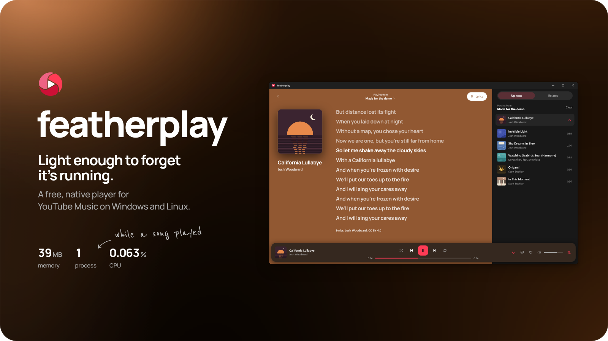
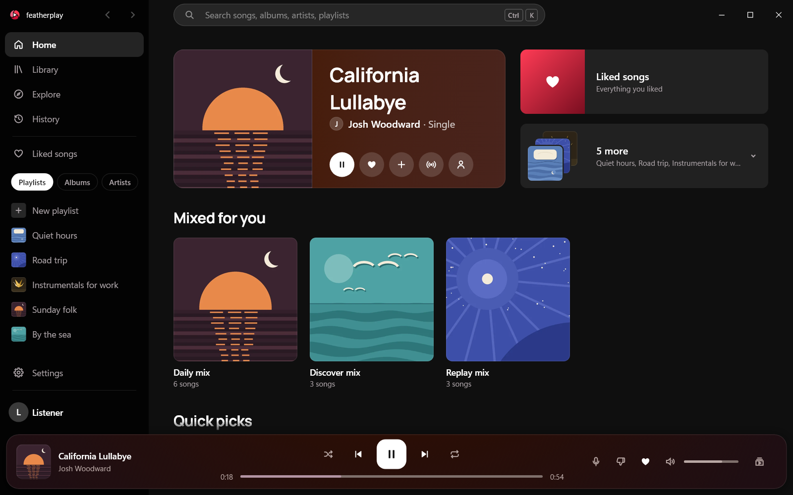
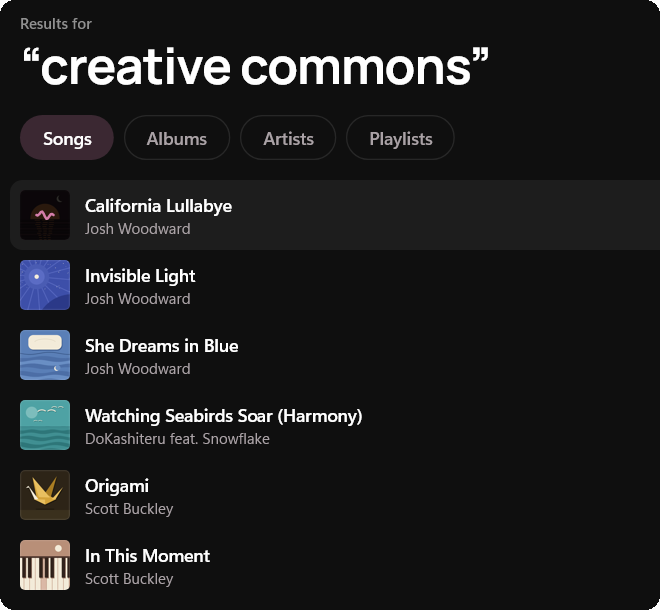
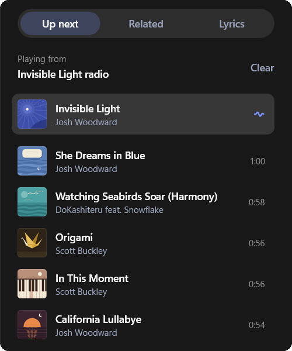
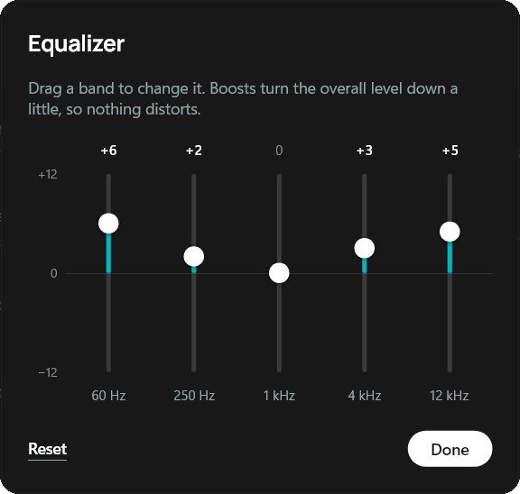
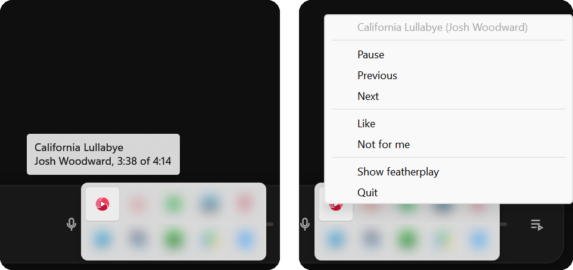
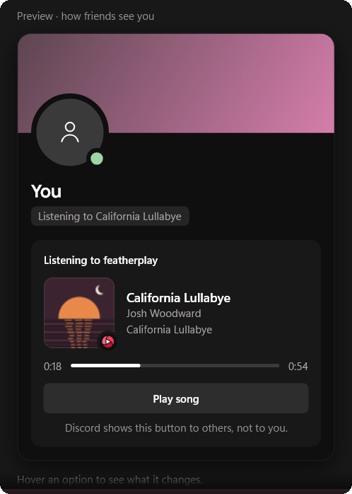
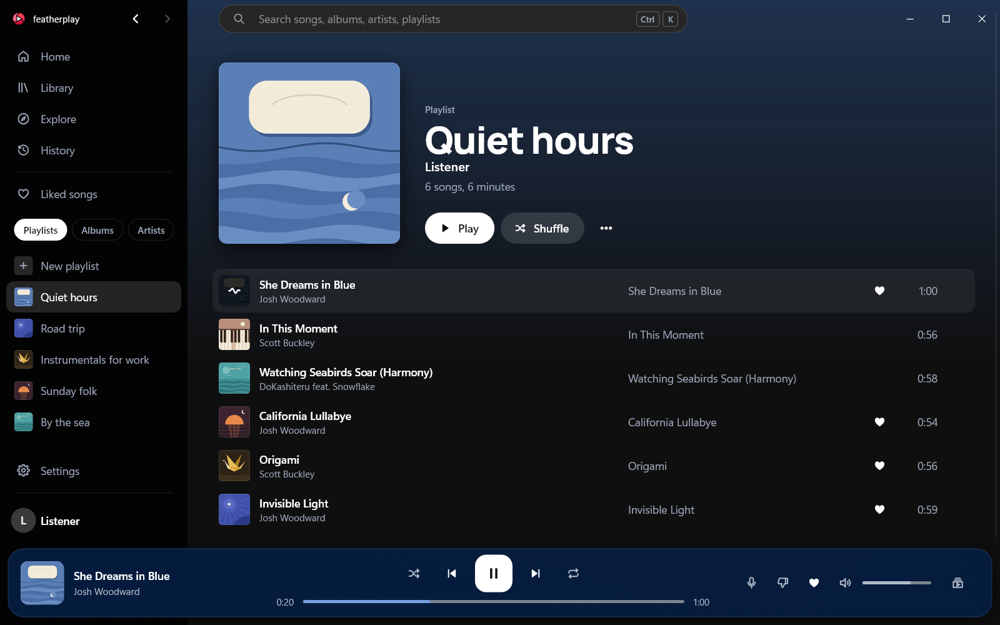
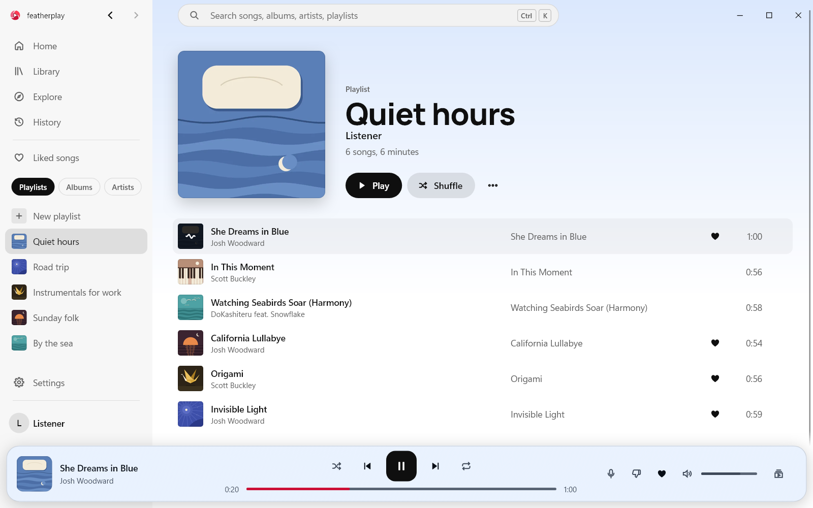
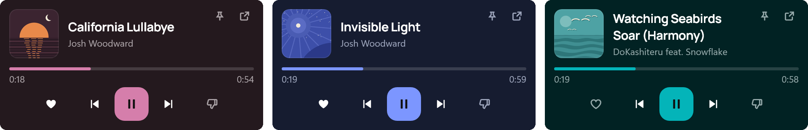

<!--
  Images in .github/readme/: offscreen `--snapshot` renders with the demo fixtures (free-licence
  songs, our own covers, a made-up account) at 1280 x 800 and 125 %, made by a script kept
  outside the repo; tray.png is the one real capture. MadeWithSlint-logo-*.svg: Slint's badge,
  unmodified (CC BY-ND 4.0), as its licence asks. now-playing-lyrics, settings-discord, search
  and mini-player stay for the site and release notes, but aren't shown here. The header
  picture is the page's h1, so tools that read the first heading find the app's name; it is
  made from the built website (its background and its live window), by a script kept outside
  the repo too.
-->

<h1 align="center">
  <picture>
    <source media="(prefers-color-scheme: light)" srcset=".github/readme/header-light.png">
    
  </picture>
</h1>

<p align="center">
  <a href="https://github.com/candygoogy/featherplay/releases/latest"><b>Download</b></a>
  &nbsp;·&nbsp; Windows 10 and 11, x64 and ARM64 &nbsp;·&nbsp;
  <a href="#linux-experimental">Linux (experimental)</a> &nbsp;·&nbsp;
  <a href="https://featherplay.candygoogy.dev">Try the demo on the website</a>
</p>

<!-- The figures in this paragraph are How light?'s, and the header picture shows them too:
     change them together. -->

featherplay plays your YouTube Music library, playlists, search results and radio in one
native program for Windows, with an experimental build for Linux. It plays the music directly
instead of loading the YouTube Music website: on the PC it was measured on, a song played in
39 MB of memory and one process, at 0.063 % of the CPU ([How light?](#how-light)). It's
written in Rust and drawn with [Slint](https://slint.dev), and it keeps what people use most
in [Pear Desktop](https://github.com/pear-devs/pear-desktop): scrobbling to Last.fm and
ListenBrainz, media keys and taskbar buttons, [SponsorBlock](https://sponsor.ajay.app) and
Discord status. It needs no YouTube Music Premium, and no account just to listen.

**Status:** young and actively developed by one person, with a release every few days since
0.1.0 on 3 November 2026 ([changelog](CHANGELOG.md)). Windows is the main platform, the Linux
build is experimental, and there's no macOS version. Free and open source under the
[MIT licence](LICENSE).

> [!NOTE]
> **Unofficial.** featherplay is an independent project. It isn't made, endorsed or supported
> by Google or YouTube, and it uses YouTube Music's private web interface, which can change
> without notice. **If playback breaks, update; YouTube changes things.**

## Why

I listen to YouTube Music every day, and until featherplay that meant Pear Desktop. Pear has a
plugin for everything, but underneath it's the YouTube Music website running in Electron, and
it can get heavy and glitchy. featherplay is the handful of things I used every day, built
into one program that opens at once and stays quiet while it plays. It leaves out:

- **The web page.** featherplay plays the music directly, with no browser engine in the
  window. Signing in uses WebView2 or a browser of your choice once, then closes it.
- **Electron.** featherplay is one native program, not a web app in a frame.
- **Video.** It never plays video. A music video with a song version plays as the song.
- **Telemetry.** No analytics and no tracking, and no server of its own.

Pear does much more than featherplay. If you rely on a plugin featherplay doesn't have, such
as Music Together, the visualizer or picture-in-picture, Pear is the better choice;
[Coming from Pear?](#coming-from-pear) goes through them plugin by plugin. featherplay also
never shows the video, so if you watch the music videos, use YouTube Music itself.

## How light?

Measured on one Windows PC with 16 logical processors, each app playing a song on repeat for
5 minutes and then paused for 3, with its window minimised. Lower is better.

<!-- Figures: featherplay 0.4.0's of 14 November 2026 (a release build of the release's code,
     made locally, three runs, the median); Pear's and Edge's of 1 November, and the
     sound-features run (0.2.0, 9 November), not repeated; 0.4.1, 0.4.2, 0.5.0, 0.6.0, 0.6.1 and 0.6.2 weren't measured again;
     the Download row is 0.6.2's files. Write-ups outside the repo; site/src/data/numbers.ts holds
     the same figures. -->

| | featherplay 0.4.0 | Pear Desktop 3.12.0 | YouTube Music in Edge 156 |
|---|---|---|---|
| Memory while playing | **39 MB** | 798 MB | 988 MB |
| Memory while paused | **37 MB** | 782 MB | 973 MB |
| CPU while playing | **0.063 %** | 0.17 % | 0.14 % |
| CPU while paused | **0.002 %** | 0.05 % | 0.018 % |
| Processes | **1** | 6 to 7 | 9 to 11 |
| Start to music playing | **0.24 s** (0.20 to 0.31 s) | not measured | not measured |
| Click to sound | **0.009 s** (0.002 to 0.29 s) | not measured | not measured |
| Download | **10.92 MB** installer (29.87 MB portable exe) | 274 MB installer | nothing (Edge comes with Windows) |

<sub>featherplay's figures are 0.4.0's, measured on 14 November 2026 (three runs, the median) on a release build of the same code as the 0.4.0 release, and weren't measured again for 0.4.1, 0.4.2, 0.5.0, 0.6.0, 0.6.1 or 0.6.2; the Download row is 0.6.2's files. Pear Desktop and Edge were measured on 1 November. Memory is the private memory of all the app's processes (1 MB = 1,048,576 bytes); CPU is a share of the whole machine. Start to music playing runs from starting featherplay to the first sound of the song it resumes (median of 6 starts); click to sound from clicking a song's play button to its first sound (median of 12 clicks). [How these were measured](https://featherplay.candygoogy.dev/method) has the method, every run, and the figures with the sound features on.</sub>

The Linux build's figures, measured in WSL, are in
[featherplay on Linux](docs/linux.md#how-light-on-linux).

## Features

<p align="center">
  <picture>
    <source media="(prefers-color-scheme: light)" srcset=".github/readme/hero-light.png">
    
  </picture>
</p>

### Find your music



- Without an account: search, artists, albums, public playlists, Home, Explore, radio and
  lyrics. Signed in: your library, likes and History, with what you played on other devices.
- Home opens on the song you left off on, with Resume and what plays next, then your shelves
  and your mixes. The sidebar holds your liked songs, playlists, albums and artists; pin any
  of them to the top.
- Search (`Ctrl+K`) filters by songs, albums, artists and playlists, and opens any YouTube or
  YouTube Music link you paste.
- Quick search, once you turn it on, opens a small search box over whatever app you're in
  (`Ctrl+Alt+K` unless you pick another).

<br clear="right">

### Listen



- A click usually plays at once: the song under the pointer, the next one in the queue and the
  one you left off on are fetched ahead.
- Radio from any song, and similar songs (or the list again) when a list ends. Up next
  reorders, removes and clears; Related shows songs like the one playing.
- Synced lyrics, from Lyrictified, Unison, LRCLIB or YouTube Music, follow the song in its cover's colour;
  click a line to jump there. Where Unison has the song timed by the word, each word lights up
  as it's sung. Set their size, move a song's timing, find other lyrics when the match is
  wrong, or keep the line being sung in a small strip above other apps.
- In the full lyrics view, Translate adds an English line under each lyric and Romanize the
  line in Latin letters, for lyrics written in another script. Both are off until you turn
  them on, there or in Settings > Lyrics.
- Songs play YouTube Music's Opus stream, and only the audio: a music video with a song
  version plays as the song, and SponsorBlock skips the talking in the music videos that
  remain.
- It opens paused, with your queue, song and position, and never starts on its own.
- A sleep timer, "Not for me" to skip a song and dislike it, and songs YouTube won't play
  shown dimmed and skipped.

<br clear="right">

### Shape the sound



All off until you turn them on, except Match song volumes.

- An equalizer with Bass, Treble and Vocal presets, or five bands of your own, and Even out
  loudness, a compressor.
- Match song volumes, Skip silence, and Crossfade over 2, 5, 8 or 12 seconds, never between
  songs of one album.
- Playback speed from 0.5× to 2×, at the same pitch.

<br clear="right">

### Fits into Windows



- Media keys and the Windows media overlay work, with the cover, title and artist, and the
  taskbar thumbnail has Previous, Play and Next.
- A left click on the tray icon opens a mini player, a right click Windows' own menu. Closing
  the window asks whether to quit or keep playing there, until you tell it to remember.
- The window opens where you left it, and narrows to 480 px, enough to sit beside other work.
  **Start when you sign in to Windows**, off by default, opens it paused, in the tray if you
  like.
- `Space` plays and pauses, `Ctrl+K` searches, `Ctrl+L` shows or hides lyrics, and `Ctrl+/`
  lists every key.
- On Linux, media keys go through MPRIS, and the tray works where the desktop has one.

<br clear="right">

### Keep track and share



- Scrobbling to Last.fm, ListenBrainz or both, with clean titles and artists. Plays that
  couldn't be sent go later.
- Discord status shows what you're playing, once you turn it on, and Settings previews what
  your friends see.
- A [local API](#local-api) for Stream Deck plugins, stream overlays and scripts, and
  [Amuse](docs/local-api.md#amuse) support for the Amuse widget, both off until you turn them on.
- The account menu switches between your Google accounts and their brand channels.

<br clear="right">

### Make it yours

- Dark, light, or System to follow Windows; the whole window crossfades as it changes.
- The accent comes from the cover that's playing, or pick a fixed colour.

<table>
  <tr>
    <td align="center"><a href=".github/readme/theme-dark.png"></a><br><sub>A playlist, dark</sub></td>
    <td align="center"><a href=".github/readme/theme-light.png"></a><br><sub>The same playlist, light</sub></td>
  </tr>
</table>



<sub>The songs in these images are free to share: "California Lullabye", "Invisible Light" and "She Dreams in Blue" by [Josh Woodward](https://www.joshwoodward.com/) (lyrics too), "Origami" and "In This Moment" by [Scott Buckley](https://www.scottbuckley.com.au/), all [CC BY 4.0](https://creativecommons.org/licenses/by/4.0/); "Watching Seabirds Soar (Harmony)" by [DoKashiteru feat. Snowflake](https://ccmixter.org/files/DoKashiteru/24925), [CC BY 3.0](https://creativecommons.org/licenses/by/3.0/). The cover art is featherplay's own, and the account is a made-up one.</sub>

[What featherplay does](docs/features.md) has every feature, with its keys and where its
setting is.

## Download

**Windows.** featherplay runs on 64-bit Windows 10 and 11, on x64 and ARM64 PCs. The
[latest release](https://github.com/candygoogy/featherplay/releases/latest) has an installer
and a portable exe for each, and lists every file's SHA256.

<!-- The installer's file name carries the version: update this link with each release. -->

| | The installer, the one to choose | The portable exe |
|---|---|---|
| Download | [`featherplay-setup-0.6.2.exe`](https://github.com/candygoogy/featherplay/releases/download/v0.6.2/featherplay-setup-0.6.2.exe) | [`featherplay.exe`](https://github.com/candygoogy/featherplay/releases/latest/download/featherplay.exe) |
| Where it goes | Your Windows user only, with no admin prompt. It adds featherplay to the Start menu and to Settings > Apps. | Any folder. Settings go in `%APPDATA%\featherplay`, the cache in `%LOCALAPPDATA%\featherplay`. |
| Updates | Downloads a new version in the background and installs it when you click **Restart to update**. | Tells you when a new version is out, but doesn't install it. |
| Visual C++ runtime | Brings its own copy. | Needs the [Visual C++ Redistributable](https://learn.microsoft.com/en-us/cpp/windows/latest-supported-vc-redist) (x64, or ARM64 for `featherplay-arm64.exe`), which most PCs already have. |

A newer setup upgrades the installed copy in place and keeps your settings and sign-in;
**Install updates automatically**, in Settings > Account, turns the automatic install off.
Uninstalling from Settings > Apps removes everything featherplay keeps;
[Removing featherplay](docs/privacy.md#removing-featherplay) has the list, and the steps for
the portable exe.

<!-- TODO(release): once the manifests in packaging/ are accepted, show
     `winget install candygoogy.featherplay` and `scoop bucket add extras` +
     `scoop install featherplay` here. -->

**Linux (experimental).** An AppImage and a `.tar.gz` for x86_64, and for aarch64 (tested
automatically only), on glibc 2.35 or newer: Ubuntu 22.04, Debian 12, Fedora 36, a current
Arch, or newer. See [Linux (experimental)](#linux-experimental) for the steps and the limits.

### "Windows protected your PC"

featherplay isn't code-signed yet, so Windows SmartScreen may warn you the first time you run
it. Choose **More info**, then **Run anyway**. To check the file first, run
`Get-FileHash featherplay-setup-0.6.2.exe` (or `Get-FileHash featherplay.exe`) in PowerShell
and compare the hash with the one on the release page, or
[build it yourself](#build-from-source).

## The first run

featherplay finds most songs' audio itself: it asks YouTube for the stream and answers the
player's challenges with yt-dlp's solver scripts in the JavaScript engine built into the app
([QuickJS-NG](https://github.com/quickjs-ng/quickjs)). On the first run it prepares YouTube's
current player at startup, which takes a few seconds, so the first song you click plays
without waiting for any download. For a song it can't get that way, it falls back to two
helper programs, yt-dlp and Deno, which it downloads in the background on the first run.

[The helpers](docs/privacy.md#the-helpers) says where they come from and how each file is
checked, and [Behind a proxy](docs/troubleshooting.md#behind-a-proxy) which proxy featherplay
goes through.

### Signing in

You don't need an account to listen. Signed out, featherplay searches, opens artists, albums
and public playlists, shows Home and Explore, and plays songs with their radio and lyrics.
Your library, liked songs, history, likes and playlists need your account. There are three
ways in:

- **Sign in with Google**, the default on Windows, opens Google's own sign-in page in a small
  Microsoft Edge WebView2 window, which Windows 11 includes and most Windows 10 PCs have with
  Edge. Linux has no such window.
- **Use Microsoft Edge**, **Use Google Chrome**, **Use Brave** or **Use Vivaldi** (or another
  channel of Chrome, Edge or Brave, or Yandex Browser; on Linux Chromium, Firefox, Opera and
  Brave Origin too) opens that browser itself, with its own address bar, your passkeys and
  Windows Hello, in a temporary profile, never your own. **Close the browser once you're
  signed in.** featherplay reads the profile only then: it keeps the YouTube Music session,
  drops every other cookie and deletes the profile.
- **Paste from any browser** works with every browser: open music.youtube.com signed in, press
  F12, open the Network tab, type browse in its filter and reload, then right-click the browse
  request, pick Copy and then Copy as cURL, and paste it. A `Cookie` header or a cookies.txt file works too.

featherplay never reads your password, and the main window never contains a browser. It keeps
the session in Windows Credential Manager, or on Linux in your desktop's keyring; the session
gives the same access to your account as a signed-in browser, so treat it like a password.
**Sign out**, in Settings > Account or the account menu, removes it.
[Signing in](docs/signing-in.md) has each way in full, and what to weigh before you use your
main account.

## Coming from Pear?

Most of Pear's plugins are settings in featherplay. Plugin by plugin, as of today:

| Pear plugin | featherplay |
|---|---|
| Scrobbler | **Built in.** Last.fm and ListenBrainz, "Scrobble other media", alternative titles and artists, and your own Last.fm API key if you want one. |
| Taskbar Media Control | **Built in** on Windows: Previous, Play/Pause and Next on the taskbar thumbnail. |
| Shortcuts | **Built in.** Media keys and the system's media controls always; your own global hotkeys in Settings > Window (off by default; not on Wayland), and a shortcut for quick search from any app. |
| SponsorBlock | **Built in**, on by default: skips non-music segments in music videos. |
| Discord Rich Presence | **Built in**, off by default, with Pear's options: status text, time display, links, the Play song button, clear after a pause, reconnect automatically. |
| Synced Lyrics | **Built in.** LRCLIB and YouTube Music's own timed lyrics, with plain lyrics as the fallback; click a line to jump to it. Three text sizes, the timing moved per song, other lyrics chosen from LRCLIB, and desktop lyrics in a strip above other apps; English translation and romanization of lyrics in another script, both off by default. A setting turns lyrics off completely. |
| Notifications | **Built in.** Track-change notifications, off by default (Settings > Window). |
| Custom Output Device | **Built in.** Pick the device in Settings > Sound; if it disappears, playback pauses and moves to the default one. |
| Exponential Volume | **Built in.** The volume slider follows a perceptual curve. |
| Precise Volume | **Built in**, as Volume step (Settings > Playback): 1, 2, 5 or 10 % for each turn of the mouse wheel over the player bar or press of Up or Down. The volume shows above the slider, or above the bar in a narrow window, while it changes. |
| Disable Autoplay | **Built in.** featherplay restores your last session paused and never starts playing by itself. |
| Video Toggle | **Built in.** Audio only, always, plus "Prefer song versions" (plays the song instead of its music video) and "Skip non-music in radio". |
| Album Color Theme | **Built in**, and the default: the accent comes from the current cover (Settings > Window > Accent: From the cover, a fixed colour or a custom one). |
| Album Actions | **Built in.** The album page's ⋯ menu: Like all songs, Remove likes, Dislike all songs, Remove dislikes. |
| Skip Disliked Songs | **Built in**, on by default, as "Skip songs I've disliked" (Settings > Playback). A song you pick yourself still plays. |
| Equalizer | **Built in**, off by default (Settings > Sound): five bands with Bass, Treble and Vocal presets, or your own. |
| Audio Compressor | **Built in**, off by default, as "Even out loudness" (Settings > Sound): Light, or Strong with Pear's settings. |
| Skip Silences | **Built in**, off by default, as "Skip silence" (Settings > Playback): the start and end of a song, or everywhere (silences of 2 s or more inside a song shortened). |
| Crossfade | **Built in**, off by default (Settings > Playback): 2, 5, 8 or 12 s, equal power, from where the music ends. Never between songs of one album; Next and Previous cut unless Fade on skip is on. |
| Playback Speed | **Built in** (Settings > Playback and the player bar): 0.5× to 2×, with the pitch kept. |
| API Server | **Built in**, off by default, as the [local API](#local-api): Pear's port, routes and WebSocket, with a token from Settings. |
| Amuse | **Built in**, off by default: [the same endpoint](docs/local-api.md#amuse) on port 9863, for the Amuse widget. |
| Tuna OBS, Lumia Stream | Not as such: overlays, bots and scripts can read the [local API](#local-api) instead. |
| In-App Menu, Navigation, Unobtrusive Player, Performance Improvement | Not needed: featherplay has its own window, menus and back and forward buttons, and nothing to tune. Closing the window can keep it playing in the tray. |
| Do Not Track, Auth Proxy | Not needed: featherplay has no telemetry. |
| Video Quality Changer, Captions Selector | Not needed: there is no video. |
| Picture-in-picture, Ambient Mode, Transparent Player, Clock, Visualizer | Later. |
| Music Together | No. |

## Linux (experimental)

The Linux build is new. Automatic tests start the AppImage, play a song and let it update
itself on Ubuntu 22.04 and 24.04, Debian stable, the latest Fedora and Arch (x86_64), and the
aarch64 build on Ubuntu 22.04 and 24.04, Debian and Fedora. Few people have used it on a real
desktop yet, so reports help, good or bad
([open an issue](https://github.com/candygoogy/featherplay/issues)). It's the same app as on
Windows, except that there's no sign-in window (you sign in in your browser and close it
when you're done) and no taskbar buttons, the session goes in your keyring, media keys work
through MPRIS, and the body text is in Inter. Under Wayland there are no global hotkeys, no
quick search shortcut and no desktop lyrics (see [Known limits](docs/linux.md#known-limits)).

**The AppImage.** Download `featherplay-x86_64.AppImage` (or `featherplay-aarch64.AppImage`)
from the [latest release](https://github.com/candygoogy/featherplay/releases/latest), then:

```sh
chmod +x featherplay-x86_64.AppImage
./featherplay-x86_64.AppImage
```

It needs FUSE's `fusermount`, which most desktops have; without it, start it with
`--appimage-extract-and-run`. In a folder you can write to, it updates itself as the Windows
installer does. The `.tar.gz` is the same program as plain files; it tells you of new versions
but doesn't install them.

[featherplay on Linux](docs/linux.md) has the rest: the `.tar.gz` steps, the packages a
minimal system needs, how to remove it, and the known limits. The main ones: no tray on stock
GNOME, and no global hotkeys or desktop lyrics on Wayland. It also lists what has only been
checked in automatic tests so far.

## Troubleshooting

**If playback stops working, update first.** If the latest version fails too,
[open an issue](https://github.com/candygoogy/featherplay/issues) with the text from
**Copy diagnostics**, on the About page (Settings > Account > About featherplay).

### Many songs "can't play", but they play in a browser or in Pear

featherplay dims them, skips them, and may say "Songs can't play: DNS reroutes YouTube." The
usual cause is a DNS service or filter that routes YouTube through its own servers in another
country, as NextDNS's YouTube option and some smart-DNS services do. YouTube then applies
that country's licensing and answers "This video is not available". A browser or Pear can
still play them, because they talk to `music.youtube.com`, which such rules tend to leave
alone.

To check, choose **Copy diagnostics** on the About page: the `DNS:` line says `normal`, or
names the addresses outside Google's own ranges that YouTube's servers resolve to, and
`YouTube's region:` is the country YouTube sees you in (often `unknown`). To fix it, either:

- turn that option off in your DNS service, then flush the DNS cache (`ipconfig /flushdns`
  on Windows, `resolvectl flush-caches` with systemd-resolved; a router can keep old answers
  for a while), or
- turn on **Look up YouTube directly** in Settings > Playback, or choose **Look up
  directly** on the notice. featherplay then asks Google's or Cloudflare's DNS over HTTPS for
  YouTube's servers only, falls back to your system's answer at once if that fails, and does
  nothing behind a proxy. Songs that need the yt-dlp helper still go by the system's DNS.

[Troubleshooting](docs/troubleshooting.md) covers the rest: signing in that doesn't work,
boxes instead of text or a tiny window on Linux, proxies, and what to put in a bug report.
The [website's questions](https://featherplay.candygoogy.dev/#questions) answer what people
ask before installing. To report a security problem privately, see [SECURITY.md](SECURITY.md).

## Privacy

featherplay sends no telemetry and has no server, only a static website. It connects to
YouTube Music and Google for your music, covers, streams and sign-in, and to GitHub for its
two helpers and its own updates (or, when GitHub can't be reached on the first run, to
featherplay's site and Deno's download server for the helpers). The rest hear from it only
when a feature needs them:

- **Lyrictified** (api.lyrictified.xyz), asked first, only while lyrics are on screen, with
  Lyrictified lyrics on (the default). It receives the song's title and nothing else;
- **Unison**, for lyrics timed by the word, only while lyrics are on screen, with Word-by-word
  lyrics on (the default). It receives the song's YouTube video ID and nothing else;
- **LRCLIB**, for lyrics, only while lyrics are on screen;
- **Google Translate**, only while lyrics are on screen and Translation or Romanization is
  on. It receives the displayed lyric lines in batches; results stay in memory for the
  session;
- **SponsorBlock**, on by default, only for music videos and uploads, asked by the first four
  characters of a hash of the video's ID, so the server doesn't learn which video you play;
- **Last.fm and ListenBrainz**, only if you connect them;
- **Discord**, only if you turn on the status, through the Discord app on your own PC;
- **Google's or Cloudflare's DNS over HTTPS**, only with Look up YouTube directly on.

Your YouTube Music session, your Last.fm session, your ListenBrainz token and the local API's
token are kept in Windows Credential Manager, or on Linux in your keyring.
[Privacy](docs/privacy.md) says what each service is sent, which folders featherplay uses, and
how to remove everything.

## Local API

For stream overlays, Stream Deck plugins and scripts on your PC: what's playing, and the
controls. It's off by default; turn on **API server** in Settings > Local API. featherplay
then listens on `http://127.0.0.1:26538`, the port of Pear Desktop's API Server, with Pear's
routes under `/api/v1/` and its WebSocket events. Every request needs the token shown in
Settings:

```sh
curl -H "Authorization: Bearer $TOKEN" http://127.0.0.1:26538/api/v1/song
curl -X POST -H "Authorization: Bearer $TOKEN" http://127.0.0.1:26538/api/v1/toggle-play
```

It answers only apps on this PC; other PCs and web pages can't reach it.
[docs/local-api.md](docs/local-api.md) lists the routes and events, and how they differ from
Pear's.

**Amuse.** For 6K Labs' Amuse now-playing widget, turn on **Amuse** in Settings > Local API.
featherplay then answers on `http://127.0.0.1:9863` as Pear's Amuse plugin does. Like Pear's
plugin, it needs no token, so while it's on, any app on this PC can see what's playing. Of web
pages, it answers only the Amuse widget's own. It only reads: there are no controls.
[docs/local-api.md](docs/local-api.md#amuse) has the details.

## Build from source

You need the Rust toolchain from [rustup](https://rustup.rs); `rust-toolchain.toml` names
the Rust version, which rustup installs on the first build. On Debian or Ubuntu, the build
also needs these packages:

```sh
sudo apt-get install pkg-config clang libfontconfig1-dev libfreetype-dev libxkbcommon-dev \
  libxkbcommon-x11-dev libwayland-dev libx11-dev libxcursor-dev libxrandr-dev libxi-dev \
  libasound2-dev libdbus-1-dev
```

Then:

```
cargo build --release -p featherplay
```

The program is `target/release/featherplay.exe` (on Linux, `target/release/featherplay`).
Official builds also compile in a Last.fm API key and secret and a Discord application ID,
from `LASTFM_API_KEY`, `LASTFM_API_SECRET` and `DISCORD_CLIENT_ID` in the environment.
Without them, Last.fm still works with your own API key (Settings > Scrobbling > API
settings), and Discord status is unavailable. [CONTRIBUTING.md](CONTRIBUTING.md) covers the
tests, the installer and the rest of a developer's setup.

For testers and packagers who supply their own yt-dlp and Deno, `FEATHERPLAY_SIDECARS_DIR`,
in any build, names the folder featherplay takes them from instead of its `sidecars` folder
in the cache.

[ARCHITECTURE.md](ARCHITECTURE.md) maps the code, crate by crate.

## Credits

- [Slint](https://slint.dev) draws the interface, with [Skia](https://skia.org) through
  [rust-skia](https://github.com/rust-skia/rust-skia); [ytmapi-rs](https://github.com/nick42d/youtui),
  a Rust port of [ytmusicapi](https://github.com/sigma67/ytmusicapi), talks to YouTube Music.
- [yt-dlp](https://github.com/yt-dlp/yt-dlp) and its challenge solver scripts
  ([yt-dlp-ejs](https://github.com/yt-dlp/ejs)) find the audio streams. featherplay runs the
  scripts in [QuickJS-NG](https://github.com/quickjs-ng/quickjs), built in through
  [rquickjs](https://github.com/DelSkayn/rquickjs); yt-dlp runs them in
  [Deno](https://deno.com).
- [Symphonia](https://github.com/pdeljanov/Symphonia) and
  [opus-decoder](https://github.com/TadeuszWolfGang/Rusopus) decode the audio, and
  [rodio](https://github.com/RustAudio/rodio) and [cpal](https://github.com/RustAudio/cpal)
  play it.
- [LRCLIB](https://lrclib.net) for synced lyrics, [Lyrictified](https://api.lyrictified.xyz) for
  hand-picked lyrics timed by the word or the line, [Unison](https://unison.betterlyrics.org)
  (from [Better Lyrics](https://github.com/better-lyrics/better-lyrics)) for lyrics timed by
  the word, [SponsorBlock](https://sponsor.ajay.app)
  for the segments it skips, and [Last.fm](https://www.last.fm) and
  [ListenBrainz](https://listenbrainz.org) for scrobbling.
- [Manrope](https://github.com/googlefonts/manrope) is the typeface, with
  [Inter](https://github.com/rsms/inter) for the body text on Linux.
- [Pear Desktop](https://github.com/pear-devs/pear-desktop), whose plugins set the list of
  what featherplay had to do.

Every crate and its licence is in [THIRD_PARTY.md](THIRD_PARTY.md).

## Licence

featherplay is free and MIT-licensed; see [LICENSE](LICENSE). There's no paid tier and no
featherplay account to make. The interface is made with Slint, used under its
[Royalty-free License 2.0](https://github.com/slint-ui/slint/blob/master/LICENSES/LicenseRef-Slint-Royalty-free-2.0.md);
the app's About page shows Slint's badge too.

<a href="https://slint.dev"><picture><source media="(prefers-color-scheme: light)" srcset=".github/readme/MadeWithSlint-logo-light.svg"></picture></a>

featherplay is an unofficial player for YouTube Music. It is not made by, endorsed by or
affiliated with Google or YouTube. YouTube Music is a trademark of Google LLC.
