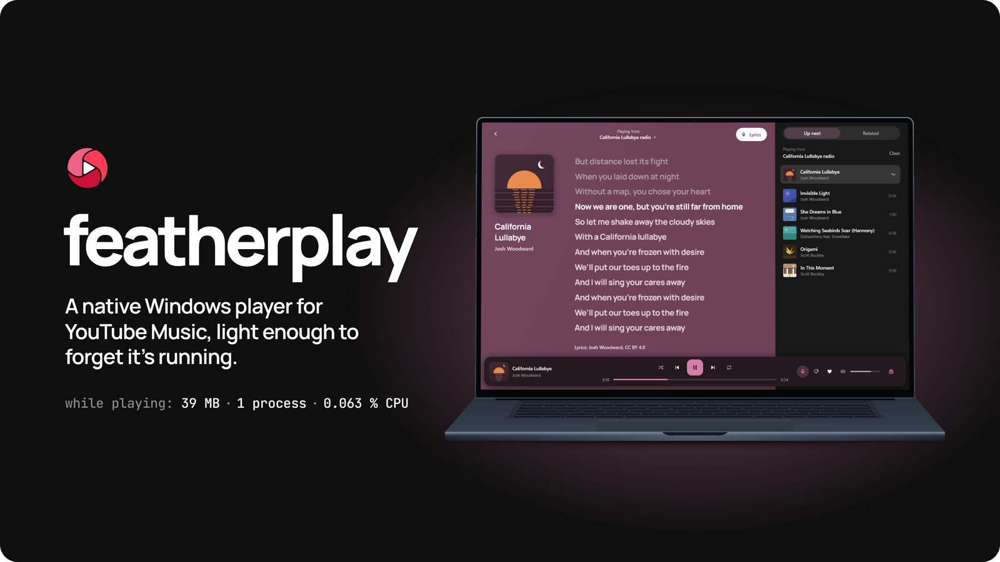
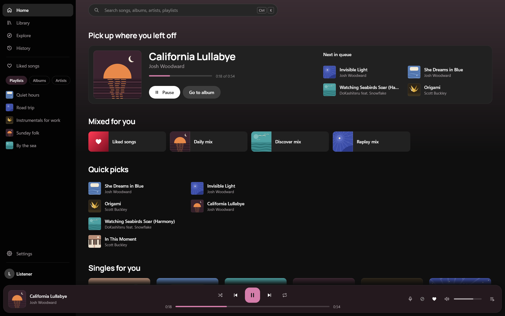
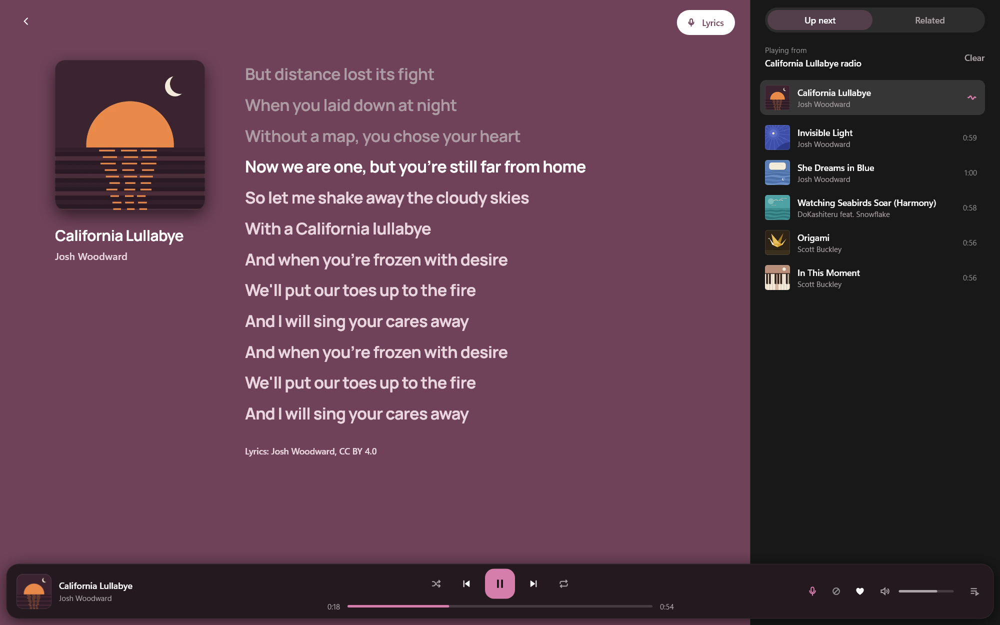
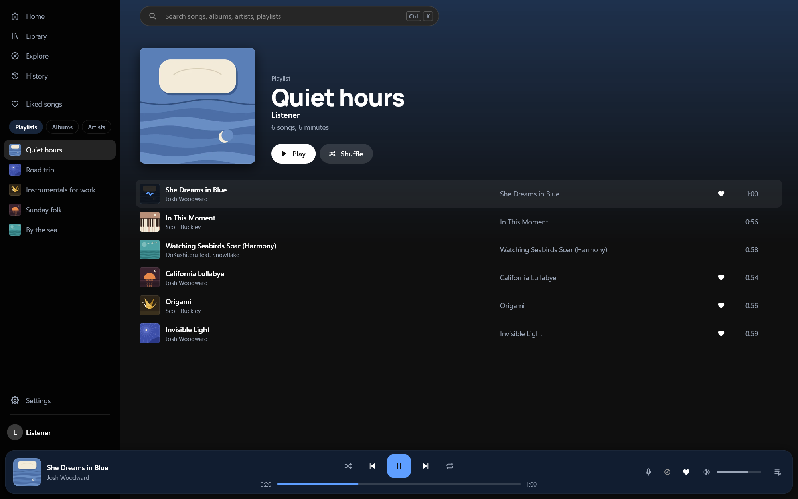
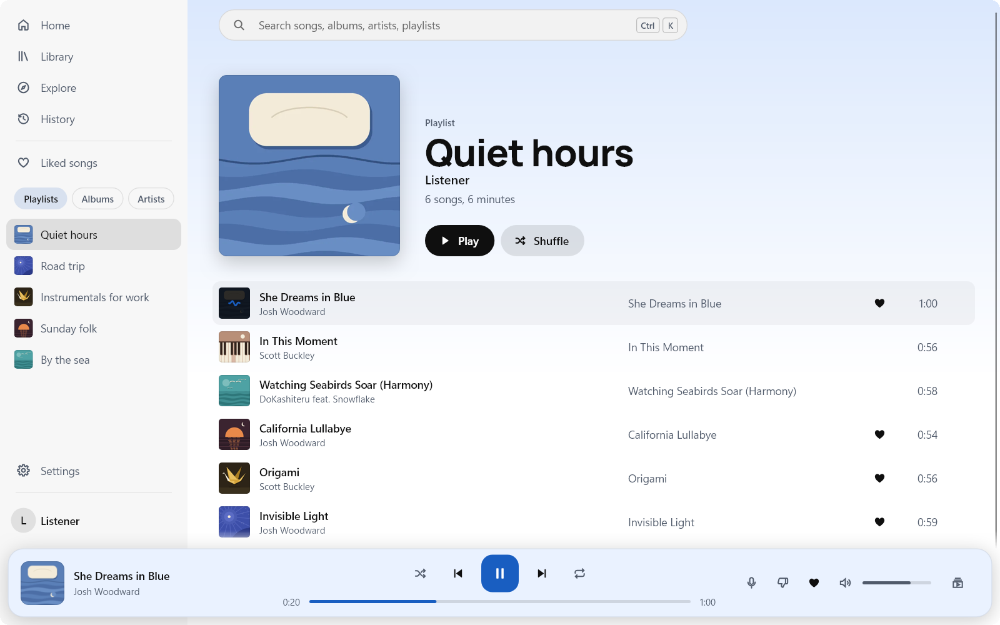
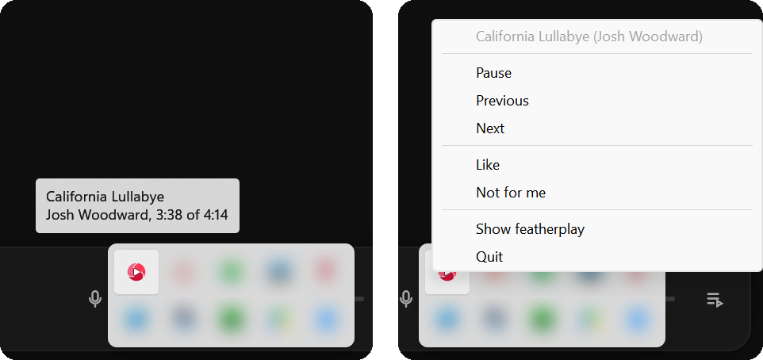
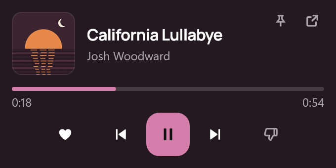

<!--
  Images in .github/readme/: rendered offscreen by featherplay's own `--snapshot` mode with the
  demo fixtures (FEATHERPLAY_FIXTURES=demo: six free-licence songs, our own cover art, a plain
  "Listener" account), not screen captures (except tray.png, below). Window 1600 x 1000 at 125 %. The script that
  renders them and composes the header is kept outside the repo.

  header-dark.png, header-light.png  The header: icon, wordmark, line, measured figures, and a laptop
                                     showing Now playing with lyrics over the cover's glow (1600 x 900).
  hero-dark.png, hero-light.png      Home with a song playing, the bar visible.
  now-playing-lyrics.png             Now playing with the full lyrics view, the current line lit.
  theme-dark.png, theme-light.png    The same playlist, same song, in each theme.
  mini-player.png                    The tray's mini player (200 %).
  tray.png                           The one real capture: the tray's tooltip and menu are Windows'
                                     own, so the snapshot mode can't draw them. A free-licence song
                                     playing (muted), the window on Settings behind; other apps'
                                     tray icons blurred (4K at 150 %).
  MadeWithSlint-logo-*.svg           Slint's attribution badge, which its Royalty-free License
                                     asks for: unmodified copies of slint-ui/slint logo/
                                     (CC BY-ND 4.0, SixtyFPS GmbH).
-->

<p align="center">
  <picture>
    <source media="(prefers-color-scheme: light)" srcset=".github/readme/header-light.png">
    
  </picture>
</p>

<p align="center">
  <a href="#install">Install</a> &nbsp;
  <a href="#features">Features</a> &nbsp;
  <a href="#screenshots">Screenshots</a> &nbsp;
  <a href="#how-light">How light?</a> &nbsp;
  <a href="#coming-from-pear">Coming from Pear?</a> &nbsp;
  <a href="#build-from-source">Build</a>
</p>

featherplay plays your YouTube Music library, playlists, search results and radio from one
native Windows program. It's written in Rust and drawn with Slint, so there's no web browser
running behind the window and nothing plays but the audio. It keeps what people use most in
Pear Desktop (scrobbling, media keys and taskbar buttons, SponsorBlock, Discord status) and
uses about a tenth of its memory ([How light?](#how-light)).

> **Unofficial.** featherplay is an independent project. It isn't made, endorsed or supported
> by Google or YouTube, and it uses YouTube Music's private web interface, which can change
> without notice. **If playback breaks, update; YouTube changes things.**

## Install

featherplay runs on Windows 10 and 11, 64-bit. Download it from the
[latest release](https://github.com/candygoogy/featherplay/releases/latest), as an installer
or as one portable exe.

<!-- The installer's file name carries the version: update this link with each release. -->

**Installer (recommended).**
[`featherplay-setup-0.1.2.exe`](https://github.com/candygoogy/featherplay/releases/download/v0.1.2/featherplay-setup-0.1.2.exe)
installs for your Windows user only, with no admin prompt, and adds featherplay to the Start
menu and to Settings > Apps. A newer setup upgrades in place and keeps your settings and
sign-in. Uninstalling from Settings > Apps removes everything featherplay keeps: settings,
cache, helpers, the sign-in window's data, and its entries in Credential Manager.

**Portable.**
[`featherplay.exe`](https://github.com/candygoogy/featherplay/releases/latest/download/featherplay.exe)
runs from any folder. Settings go to `%APPDATA%\featherplay` and the cache to
`%LOCALAPPDATA%\featherplay`. To remove it, delete the exe and those two folders, then open
Credential Manager and remove the Windows Credentials whose names end in `.featherplay`.
It needs the
[Visual C++ Redistributable](https://learn.microsoft.com/en-us/cpp/windows/latest-supported-vc-redist)
(x64, or ARM64 for `featherplay-arm64.exe`), which most PCs already have; the installer brings
its own copy.

The release page lists each file's SHA256.

<!-- TODO(release): show these once the manifests in packaging/ are accepted.

**winget**

```
winget install candygoogy.featherplay
```

**Scoop**

```
scoop bucket add extras
scoop install featherplay
```
-->

### "Windows protected your PC"

featherplay isn't code-signed yet, so Windows SmartScreen may warn you the first time you run
it. Choose **More info**, then **Run anyway**. To check the file first, run
`Get-FileHash featherplay-setup-0.1.2.exe` (or `Get-FileHash featherplay.exe`) in PowerShell
and compare the hash with the one on the release page, or
[build it yourself](#build-from-source).

### The first run

featherplay finds each song's audio with two helper programs,
[yt-dlp](https://github.com/yt-dlp/yt-dlp) and [Deno](https://github.com/denoland/deno). On
the first run it downloads them from their GitHub releases and checks each file against a
SHA256 written into featherplay's code; a file that doesn't match is deleted, not run. After
that it updates yt-dlp at most once a day, because YouTube changes often. They live in
`%LOCALAPPDATA%\featherplay\sidecars`.

### Signing in

You don't have to sign in. Without an account featherplay searches, opens artists, albums
and public playlists, shows Home and Explore, and plays songs with their radio and lyrics.
Your library, liked songs, history, likes and playlists need your account; their pages and
buttons ask you to sign in.

featherplay signs you in through a small window, Microsoft Edge WebView2, that shows Google's
own sign-in page. Windows 11 includes WebView2, and most Windows 10 PCs have it with Edge. You
sign in there as you would in a browser. The window has a slim browser frame: back, reload,
and the page's address with a padlock, read from WebView2 itself rather than from the page, so
you can see you're on Google's own sign-in page (it says "Google's page" there). featherplay
doesn't read your password; the code is open. Once you're in, it keeps the YouTube Music
session from that window and closes it. The main window never contains a browser.

If you'd rather sign in in a browser you know, choose **Use Microsoft Edge**. Edge
opens with a temporary profile of its own, with Edge's address bar and padlock, and your
passkeys and Windows Hello work as usual. featherplay never touches your own Edge profile. It
talks to that Edge over a private pipe, not a network port, and the only things it can ask
are the profile's cookies and for Edge to close. Once you're signed in, it keeps the YouTube
Music session, drops every other cookie, closes Edge and deletes the temporary profile. If
you close Edge or don't sign in within 10 minutes, nothing is kept. **Switch Google account**
in the account menu still uses the small window, because it remembers the accounts you've
signed in with. If an Edge policy on your PC turns that connection off
(`RemoteDebuggingAllowed`), the Edge option says it isn't available on this PC, and **Why?**
explains.

The session is stored in Windows Credential Manager. yt-dlp takes cookies as a file, so
while it looks up a song's audio, featherplay writes the session to a temporary file in
`%LOCALAPPDATA%\featherplay\tmp` and deletes it as soon as yt-dlp is done. If featherplay is
killed before it can, it deletes the leftover file the next time it starts signed in. The
session gives the same access to your account as a signed-in browser, so treat it like a
password. **Sign out** in Settings removes it.

You can also paste a `Cookie` header from a signed-in browser instead. A session copied that
way can stop working after a while, because the browser keeps renewing its own copy.

## Why

I listen to YouTube Music every day, and until featherplay that meant Pear Desktop. Pear has a
plugin for everything, but underneath it's the YouTube Music website running in Electron, and
it can get heavy and glitchy. featherplay is the handful of things I used every day, built
into one program that opens at once and stays quiet while it plays.

## Features

### Find your music

- **No account needed to listen.** Search, artists, albums, public playlists, Home, Explore,
  radio and lyrics work signed out. Sign in for your library, likes and history.
- **Home, Explore and History.** Your Home shelves, new releases, charts, moods and genres,
  and what you played recently, including on other devices.
- **Your library.** Liked songs, your playlists and saved ones, albums and artists, in the
  sidebar with the most recently played first.
- **Search.** Songs, albums, artists and playlists, with filters (`Ctrl+K`). Paste a YouTube
  or YouTube Music link and it finds the song.
- **Album, playlist and artist pages,** and a right-click menu on songs and playlists: play
  next, add to queue, add to a playlist, start a radio, rename or delete your own playlists.

### Listen

- **Plays on the click.** Songs you hover over, the next one in the queue and the one you
  left off on are fetched ahead, so a click usually plays at once.
- **Radio and autoplay.** Start a radio from any song. When a list ends, similar songs follow
  (or, if you prefer, the list starts over).
- **Up next.** Reorder, remove and clear the queue; Related shows songs like the one playing.
- **Synced lyrics.** Lines follow the song in its cover's colour, and a click on a line jumps
  there. They come from LRCLIB or YouTube Music, and only while lyrics are on screen; turn
  Show lyrics off and featherplay never looks them up.
- **Opus where there is one.** Songs play YouTube Music's Opus stream, which sounds better than
  AAC at about the same data use; Settings > Sound > Streaming quality switches to AAC.
- **Songs, not videos.** featherplay never plays video. When a music video has a song version,
  the song plays, so there are no skits or intros, and radio leaves out user uploads and
  podcast episodes. SponsorBlock skips the talking in the music videos that remain.
- **Picks up where you stopped.** It opens with your queue, the song and the position,
  paused. It never starts playing on its own.
- **Likes.** Like a song, or mark it "Not for me" to skip it and dislike it on YouTube Music.
- **Output device and volume.** Pick the device in Settings; if it goes away, playback pauses
  and moves to the default one. The volume slider follows a curve that matches how loudness
  sounds.

### Fits into Windows

- **Media keys and the Windows media overlay,** with the cover, title and artist.
- **Previous, Play and Next on the taskbar thumbnail.**
- **The notification area.** A left click opens a mini player; a right click opens Windows'
  own menu. Closing the window asks whether to quit or keep playing there, until you tell it
  to remember.
- **Keyboard and mouse.** `Space` plays and pauses (unless you're typing in a field),
  `Ctrl+K` searches and `Ctrl+L` shows or hides lyrics. `Alt+Left` and `Alt+Right`, or the
  mouse's back and forward buttons, move between pages.
- **Optional extras,** off until you turn them on: notifications when the song changes, and
  global hotkeys you choose.

### Keep track and share

- **Scrobbling** to Last.fm, ListenBrainz or both, with clean titles and artists. Plays that
  couldn't be sent wait and go later.
- **Discord status** shows what you're playing, off until you turn it on. Settings shows a
  preview of what your friends see.
- **Stream overlays.** A [local API](#local-api) for Stream Deck, overlays and scripts, and
  [Amuse](#amuse) support; both are off until you turn them on.
- **Accounts.** Switch between your Google accounts and their brand channels from the
  account menu.

### Make it yours

- **Dark, light, or follow Windows.**
- **The accent comes from the cover** that's playing, or pick a fixed colour.

## Screenshots

<table>
  <tr>
    <td align="center" colspan="2"><picture><source media="(prefers-color-scheme: light)" srcset=".github/readme/hero-light.png"></picture><br><sub>Home</sub></td>
  </tr>
  <tr>
    <td align="center" colspan="2"><a href=".github/readme/now-playing-lyrics.png"></a><br><sub>Now playing, with lyrics</sub></td>
  </tr>
  <tr>
    <td align="center"><a href=".github/readme/theme-dark.png"></a><br><sub>Dark</sub></td>
    <td align="center"><a href=".github/readme/theme-light.png"></a><br><sub>Light</sub></td>
  </tr>
  <tr>
    <td align="center"><a href=".github/readme/tray.png"></a><br><sub>The tray</sub></td>
    <td align="center"><a href=".github/readme/mini-player.png"></a><br><sub>Mini player</sub></td>
  </tr>
</table>

<sub>The songs in these images are free to share: "California Lullabye", "Invisible Light" and "She Dreams in Blue" by [Josh Woodward](https://www.joshwoodward.com/) (lyrics too), "Origami" and "In This Moment" by [Scott Buckley](https://www.scottbuckley.com.au/), all [CC BY 4.0](https://creativecommons.org/licenses/by/4.0/); "Watching Seabirds Soar (Harmony)" by [DoKashiteru feat. Snowflake](https://ccmixter.org/files/DoKashiteru/24925), [CC BY 3.0](https://creativecommons.org/licenses/by/3.0/). The cover art is featherplay's own, and the account is a made-up one.</sub>

## How light?

Measured on one Windows PC with 16 logical processors, each app playing the same song with
its window minimised, on the same day. Lower is better.

<!-- Figures: the final measurement of 1 November 2026, whose write-up is kept outside the
     repo. The website's site/src/data/numbers.ts holds the same figures, so keep the two in
     step. -->

| | featherplay 0.1.2 | Pear Desktop 3.12.0 | YouTube Music in Edge 156 |
|---|---|---|---|
| Memory while playing | **81 MB** | 798 MB | 988 MB |
| Memory while paused | **80 MB** | 782 MB | 973 MB |
| CPU while playing | **0.022 %** | 0.17 % | 0.14 % |
| CPU while paused | **0.005 %** | 0.05 % | 0.018 % |
| Processes | **1** | 6 to 7 | 9 to 11 |
| Download | **10.73 MB** installer (29.95 MB portable exe) | 274 MB installer | nothing (Edge comes with Windows) |

<sub>Measured on 1 November 2026: each app playing the same song on repeat for 5 minutes, then paused for 3, window minimised. Memory is the private memory of all the app's processes (1 MB = 1,048,576 bytes); CPU is a share of the whole machine. [How these were measured](https://featherplay.candygoogy.dev/method).</sub>

Pear does much more than featherplay, and [Coming from Pear?](#coming-from-pear) lists which
of its plugins carry over. Its own tracker has several reports about resource use (titles as
written there):

- ["Is 30+% CPU usage normal when running the app?"](https://github.com/pear-devs/pear-desktop/issues/4584) (#4584)
- ["[Bug]: Rather High CPU Usage"](https://github.com/pear-devs/pear-desktop/issues/4193) (#4193)
- ["[Bug]: Is this much memory usage normal?"](https://github.com/pear-devs/pear-desktop/issues/4621) (#4621)
- ["[Bug]: Very high memory usaage"](https://github.com/pear-devs/pear-desktop/issues/4450) (#4450)
- ["[Bug]: App takes a long time to load (slow)"](https://github.com/pear-devs/pear-desktop/issues/3379) (#3379)
- ["feat(memory-saver): Add plugin that reloads the page to reclaim leaked memory"](https://github.com/pear-devs/pear-desktop/pull/4617) (pull request #4617)

## Coming from Pear?

Pear's plugins become settings here. This is what exists today.

| Pear plugin | featherplay |
|---|---|
| Scrobbler | **Built in.** Last.fm and ListenBrainz, "Scrobble other media", alternative titles and artists, and your own Last.fm API key if you want one. |
| Taskbar Media Control | **Built in.** Previous, Play/Pause and Next on the taskbar thumbnail. |
| Shortcuts | **Built in.** Media keys and the Windows media overlay always; configurable global hotkeys in Settings (off by default). |
| SponsorBlock | **Built in**, on by default: skips non-music segments in music videos. |
| Discord Rich Presence | **Built in**, off by default, with Pear's options: status text, time display, links, the Play song button, clear after a pause, reconnect automatically. |
| Synced Lyrics | **Built in.** LRCLIB and YouTube Music's own timed lyrics, with plain lyrics as the fallback; click a line to jump to it. A setting turns lyrics off completely. |
| Notifications | **Built in.** Track-change notifications, off by default. |
| Custom Output Device | **Built in.** Pick the device in Settings; if it disappears, playback pauses and moves to the default one. |
| Exponential Volume | **Built in.** The volume slider follows a perceptual curve. |
| Disable Autoplay | **Built in.** featherplay restores your last session paused and never starts playing by itself. |
| Video Toggle | **Built in.** Audio only, always, plus "Prefer song versions" (plays the song instead of its music video) and "Skip non-music in radio". |
| Album Color Theme | **Built in**, and the default: the accent comes from the current cover (Settings > Accent: From the cover, or a fixed or custom colour). |
| In-App Menu, Navigation, Unobtrusive Player, Performance Improvement | Not needed: featherplay has its own window, menus and back and forward buttons, and nothing to tune. Closing the window can keep it playing in the notification area. |
| Precise Volume | Later. |
| Album Actions, Skip Disliked Songs | Later. |
| Picture-in-picture, Ambient Mode, Transparent Player, Clock | Later. |
| Equalizer | **Built in**, off by default (Settings > Sound): five bands with Bass, Treble and Vocal presets, or your own. |
| Audio Compressor | **Built in**, off by default, as "Even out loudness" (Settings > Sound): Light, or Strong with Pear's settings. |
| Skip Silences | **Built in**, off by default, as "Skip silence" (Settings > Playback): the start and end of a song, or everywhere (silences of 2 s or more inside a song shortened). |
| Crossfade | **Built in**, off by default (Settings > Playback): 2-12 s, equal power, from where the music ends. Never between songs of one album; Next and Previous cut unless Fade on skip is on. |
| Visualizer | Later. |
| Playback Speed | **Built in** (Settings > Playback and the player bar): 0.5-2×, with the pitch kept. |
| API Server | **Built in**, off by default, as the [local API](#local-api): Pear's port, routes and WebSocket, with a token from Settings. |
| Amuse | **Built in**, off by default: [the same endpoint](#amuse) on port 9863, for the Amuse widget. |
| Tuna OBS, Lumia Stream | Not as such: overlays, bots and scripts can read the [local API](#local-api) instead. |
| Do Not Track, Auth Proxy | No: not needed. featherplay has no telemetry. |
| Video Quality Changer, Captions Selector | No: there is no video. |
| Music Together | No. |

## Local API

For stream overlays, Stream Deck plugins and scripts on your PC: what's playing, and the
controls. It's off by default; turn it on in Settings > Local API. featherplay
then listens on `http://127.0.0.1:26538`, the port of Pear Desktop's API Server (change it in
Settings). Every request needs the token shown there: **Copy** puts it on the clipboard (kept
out of the clipboard history), **Regenerate** replaces it and disconnects the apps using the
old one.

```sh
curl -H "Authorization: Bearer $TOKEN" http://127.0.0.1:26538/api/v1/song
curl -X POST -H "Authorization: Bearer $TOKEN" http://127.0.0.1:26538/api/v1/toggle-play
curl -X POST -H "Authorization: Bearer $TOKEN" -d '{"seconds": 30}' http://127.0.0.1:26538/api/v1/seek-to
```

The routes are under `/api/v1/`, as in Pear's API Server:

| Route | What it does |
|---|---|
| `GET song` (or `song-info`) | The current song: `title`, `artist`, `album`, `imageSrc`, `videoId`, `songDuration`, `elapsedSeconds`, `isPaused`. 204 when nothing is loaded. |
| `GET volume`, `shuffle`, `repeat-mode`, `like-state` | The volume (0 to 100), shuffle, repeat (`NONE`, `ALL`, `ONE`) and the song's like. |
| `POST play`, `pause`, `toggle-play`, `next`, `previous` | The transport. |
| `POST seek-to`, `go-back`, `go-forward` with `{"seconds": 30}` | Seek to a time, or skip back or forward. |
| `POST volume` with `{"volume": 50}` | Set the volume. |
| `POST shuffle`, `POST switch-repeat` with `{"iteration": 1}` | Turn shuffle on or off; press Repeat that many times. |
| `GET ws?token=…` | A WebSocket: `PLAYER_INFO` first, then `VIDEO_CHANGED`, `PLAYER_STATE_CHANGED`, `POSITION_CHANGED`, `VOLUME_CHANGED`, `REPEAT_CHANGED` and `SHUFFLE_CHANGED` as they happen. |

Messages go out only when something changes. A position comes in whole seconds with a
`timestamp`, the Unix time in milliseconds when the song was at that second, so a client moves
the time on by itself while `isPlaying`.

How it differs from Pear's: one token from Settings instead of Pear's `/auth/{id}` prompt (in
a tool made for Pear, paste the token where it asks for one; a tool that only knows the prompt
won't connect), and no queue, search, like, mute, fullscreen or Swagger routes. `muted` is
always `false` and `views` is 0.

It answers this PC only: it listens on 127.0.0.1 (and ::1), and refuses requests whose `Host`
isn't that address and port, and requests from web pages (an `Origin` other than `null` or
`file://`). It sends no CORS headers, so a page in a browser can't read it. A browser overlay
needs a helper on the PC that talks to the API for it.

### Amuse

For 6K Labs' Amuse now-playing widget, turn on **Amuse** in Settings >
Local API. featherplay then answers on `http://127.0.0.1:9863` as Pear's Amuse plugin does:
`GET /query` (or `/api`) returns the song.

```json
{ "player": { "hasSong": true, "isPaused": false, "seekbarCurrentPosition": 42 },
  "track": { "title": "…", "author": "…", "duration": 215, "cover": "https://…",
             "url": "https://music.youtube.com/watch?v=…", "id": "…", "isAdvertisement": false } }
```

Times are whole seconds. Like Pear's plugin, it needs no token and answers web pages too, so
while it's on, any app on this PC, and any website open in a browser on it, can see what's
playing. It only reads: there are no controls.

## What it leaves out

- **Chromium.** There's no browser engine in the window. Signing in uses Windows' own
  WebView2 (or Microsoft Edge, if you choose it) once, then closes it.
- **Electron.** featherplay is one native program, not a web app in a frame.
- **Video.** It never plays video. A music video with a song version plays as the song.
- **Telemetry.** No analytics and no tracking, and no server of its own.

## Questions

**Is my account safe with it?** The session stays on your PC, in Credential Manager, and the
code is public. It's still an unofficial client using YouTube Music in a way Google doesn't
support; if that worries you, sign in with a second account.

**I don't want to type my Google password into an app's window.** Choose **Use Microsoft
Edge** on the sign-in page. You sign in in Edge itself, with its own address bar,
passkeys and Windows Hello, in a temporary profile that's deleted afterwards. featherplay
doesn't read your password; the code is open.

**Playback stopped working.** Update featherplay first. If the latest version fails too,
[open an issue](https://github.com/candygoogy/featherplay/issues).

**Why only Windows?** featherplay is built on Windows' own parts: the media overlay, the
taskbar buttons, the notification area and Credential Manager. That's a lot of what keeps it
light. There's no macOS or Linux version.

**Is it free?** Yes. It's open source under the MIT licence, and there's no paid tier and no
featherplay account to make.

**How do I report a bug?** [Open an issue](https://github.com/candygoogy/featherplay/issues)
with what you did, what you expected and what happened, and the version from Settings, About.

**Logs and bug reports.** featherplay keeps a log in `%LOCALAPPDATA%\featherplay\logs`, with
a `crash-….txt` file for each crash; Settings, About, **Open log folder** opens it. **Copy
diagnostics**, beside it, copies the versions, which services are on and the last playback
errors as plain text to paste into an issue. Cookies, tokens and keys are masked in both, and
neither names your account.

## Privacy

featherplay sends no telemetry and has no server. It connects to:

- **YouTube Music and Google**, for your music, covers, streams and sign-in;
- **GitHub**, to download yt-dlp and Deno on the first run and to update yt-dlp. With "Check
  for updates" on (the default), also once a day at startup, to ask whether a newer
  featherplay is out, and when songs keep failing to play, to look for a newer release or a
  known problem. It's sent nothing but the app's version;
- **LRCLIB**, for lyrics, only while lyrics are on screen. It gets the song's title, artist,
  album and length;
- **SponsorBlock**, on by default, only for music videos and uploads (songs have nothing to
  skip). It asks by the first four characters of a hash of the video's ID, so the server
  doesn't learn which video you play;
- **Last.fm and ListenBrainz**, only if you connect them;
- **Discord**, only if you turn on the status, through the Discord app on your own PC.

The [local API](#local-api), off by default, sends nothing anywhere: it listens on 127.0.0.1
for apps on your PC that have its token. The [Amuse](#amuse) endpoint, off by default too,
has no token: while it's on, any app on your PC, and any website open in a browser on it, can
see what's playing.

Your YouTube Music session, your Last.fm session, your ListenBrainz token and the local API's
token are kept in Windows Credential Manager. Settings, the play queue and the scrobbles waiting to be sent are
in `%APPDATA%\featherplay`; covers, the helpers and the sign-in window's data are in
`%LOCALAPPDATA%\featherplay`. Signing in with Microsoft Edge uses a temporary Edge profile in
that folder too, deleted as soon as the sign-in ends (or at the next start, if featherplay was
killed meanwhile); featherplay keeps only its YouTube Music cookies. The song links looked up
in the last session are kept there until they expire (a few hours), so songs start sooner
after a restart; like every YouTube stream link, each one contains your public IP address.

## Build from source

You need Windows and the Rust toolchain from [rustup](https://rustup.rs); `rust-toolchain.toml`
picks stable.

```
cargo build --release -p featherplay
```

The exe is `target/release/featherplay.exe`. Official builds also compile in a Last.fm API
key and a Discord application ID, read from three environment variables when building:

```
LASTFM_API_KEY
LASTFM_API_SECRET
DISCORD_CLIENT_ID
```

Without them, Last.fm still works with your own API key (Settings, Scrobbling, API settings),
and Discord status is unavailable. Set `FEATHERPLAY_HOME` to keep settings, cache and helpers
in one folder of your choice, for example while developing.

Tests run with [cargo-nextest](https://nexte.st), because each app test needs its own process:

```
RUSTFLAGS="--cfg ci" cargo nextest run --workspace
cargo test --workspace --doc
```

`--cfg ci` keeps tests from opening an audio device.

The installer needs [Inno Setup](https://jrsoftware.org/isinfo.php) 6.7 or later.
`packaging/windows/build-installer.sh` builds the exe and then
`target/installer/featherplay-setup-<version>.exe`; its header lists the settings.

## Credits

- [Slint](https://slint.dev) draws the interface, with [Skia](https://skia.org) through
  [rust-skia](https://github.com/rust-skia/rust-skia).
- [ytmapi-rs](https://github.com/nick42d/youtui), a Rust port of
  [ytmusicapi](https://github.com/sigma67/ytmusicapi), talks to YouTube Music.
- [yt-dlp](https://github.com/yt-dlp/yt-dlp) and its challenge solver scripts
  ([yt-dlp-ejs](https://github.com/yt-dlp/ejs)), run by [Deno](https://deno.com), find the
  audio streams.
- [rodio](https://github.com/RustAudio/rodio), [Symphonia](https://github.com/pdeljanov/Symphonia)
  and [cpal](https://github.com/RustAudio/cpal) decode and play the audio.
- [LRCLIB](https://lrclib.net) for synced lyrics, [SponsorBlock](https://sponsor.ajay.app)
  for the segments it skips, and [Last.fm](https://www.last.fm) and
  [ListenBrainz](https://listenbrainz.org) for scrobbling.
- [Manrope](https://github.com/googlefonts/manrope) is the typeface.
- [Pear Desktop](https://github.com/pear-devs/pear-desktop), whose plugins set the list of
  what featherplay had to do.

Every crate and its licence is in [THIRD_PARTY.md](THIRD_PARTY.md).

## Licence

featherplay is MIT-licensed; see [LICENSE](LICENSE). The interface is made with Slint, used
under its
[Royalty-free License 2.0](https://github.com/slint-ui/slint/blob/master/LICENSES/LicenseRef-Slint-Royalty-free-2.0.md);
the app's About page shows Slint's badge too.

<a href="https://slint.dev"><picture><source media="(prefers-color-scheme: light)" srcset=".github/readme/MadeWithSlint-logo-light.svg"></picture></a>

featherplay is an unofficial player for YouTube Music. It is not made by, endorsed by or
affiliated with Google or YouTube. YouTube Music is a trademark of Google LLC.
